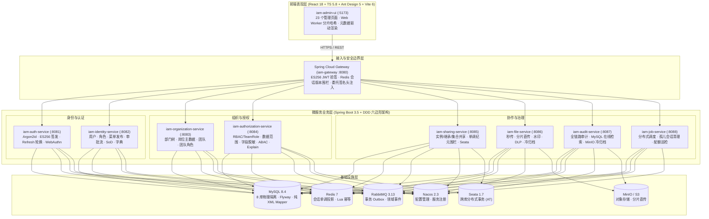

# Enterprise IAM & Dynamic Fine-Grained Authorization Platform

> 企业级多租户统一身份认证与动态细粒度授权平台（Monorepo），版本 `1.10.1-SNAPSHOT` `[Data-backed]`。平台贯彻 SPEC 01 ~ SPEC 47 规范体系，以权限即数据、默认拒绝、故障闭合、多租户强隔离为核心准则 `[Data-backed]`。

---

## 1. 项目定位

Enterprise IAM 面向现代化企业的复杂组织架构与多云环境，解决传统 RBAC 模型在多租户、矩阵式组织、行级数据隔离、列级敏感脱敏、ABAC 动态规则与资源级跨租户共享场景下的治理瓶颈。

平台在以下方面区别于通用 IAM 方案 `[Data-backed]`：

- 权限即数据（Permission As Data）：前端不硬编码角色或权限字符，导航树、按钮操作集与表格列安全策略由服务端元数据引擎动态派发，并支持离线降级。
- 默认拒绝与故障闭合（Default Deny & Fail-Closed）：授权引擎在策略未命中、投影纪元滞后、Condition DSL 越界或下游依赖不可用时，一律阻断放行。
- 业务主数据与授权模型解耦：部门、岗位为组织主数据，角色与团队角色为授权实体，两者互不混淆。
- 动态菜单三级建模：目录、菜单、按钮三级树形结构，草稿与发布两阶段上线，发布后全局生效。
- 审批流真实落地：角色、团队角色、资源分享三类申请审批通过后，自动触发底层实体落库。
- 100% MyBatis-Plus + XML 参数化绑定：生产代码禁用内联 SQL、注解 SQL 与字符串拼接，统一用 `#{}` 参数绑定。
- 全链路防精度丢失：所有 64 位整型 ID 在 JSON 边界序列化为十进制字符串。

---

## 2. 系统架构



---

## 3. 仓库结构

```text
enterprise-iam/
├── backend/                                   # 后端 Reactor（Java 21 + Spring Boot 3.5）
│   ├── pom.xml                                # 根 POM (1.10.1-SNAPSHOT)
│   ├── iam-dependencies/                      # 统一依赖版本 BOM
│   ├── iam-framework/                         # 18 个公共 Starter 与基础库
│   │   ├── iam-common-core/                   # 领域上下文、TraceId、权限模型
│   │   ├── iam-common-security/               # Argon2id、ES256、JWKS、委托上下文
│   │   ├── iam-common-mybatis/                # MyBatis-Plus 配置与 XML 规范
│   │   ├── iam-common-redis/                  # Redis 缓存与会话版本校验
│   │   ├── iam-common-mq/                     # RabbitMQ 事件发布与幂等消费
│   │   ├── iam-common-tenant/                 # 多租户上下文与隔离
│   │   ├── iam-common-lock/                   # 分布式锁
│   │   ├── iam-common-transaction/            # 事务管理
│   │   ├── iam-common-observability/          # 可观测性
│   │   ├── iam-common-web/                    # Web 响应与异常处理
│   │   ├── iam-idempotent-spring-boot-starter/   # Redis Lua 原子幂等
│   │   ├── iam-outbox-spring-boot-starter/       # 事务 Outbox 事件分发
│   │   ├── iam-security-spring-boot-starter/      # 网关委托令牌校验
│   │   ├── iam-data-permission-spring-boot-starter/ # 行级数据权限切面
│   │   ├── iam-field-permission-spring-boot-starter/# 列级字段权限与脱敏
│   │   ├── iam-authorization-client-spring-boot-starter/
│   │   ├── iam-api-discovery-spring-boot-starter/
│   │   └── iam-audit-spring-boot-starter/
│   ├── iam-gateway/                           # API 网关（:8080）
│   ├── iam-auth-service/                      # 认证中心（:8081）
│   ├── iam-identity-service/                  # 身份/用户/菜单/角色/审批（:8082）
│   ├── iam-organization-service/              # 组织/部门/岗位/团队（:8083）
│   ├── iam-authorization-service/             # 多维授权决策引擎（:8084）
│   ├── iam-sharing-service/                   # 资源细粒度共享（:8085）
│   ├── iam-file-service/                      # 文件传输与 DLP（:8086）
│   ├── iam-audit-service/                     # 安全审计（:8087）
│   ├── iam-job-service/                       # 分布式调度（:8088）
│   ├── iam-test-support/                      # 测试支撑库
│   └── scripts/                               # 运维脚本（如超管密码重置）
├── frontend/iam-admin-ui/                     # 前端（React 18 + TS 5.8 + Vite 6 + pnpm）
│   ├── src/
│   │   ├── api/                               # 按业务域划分的 HTTP 模块
│   │   ├── app/router/                        # 路由与动态加载
│   │   ├── constants/navigation.ts            # 本地保底导航 Schema 与图标
│   │   ├── hooks/useServerMetadata.ts         # 服务端元数据驱动 Hook
│   │   ├── features/file-management/          # 分片上传、Web Worker 哈希、上传队列
│   │   └── pages/                             # 23 个管理页面
├── docs/
│   └── spec/spec.md                           # SPEC 01 ~ SPEC 47 权威规划
├── deploy/                                    # 部署清单
│   ├── docker-compose.yml                     # 基础设施编排
│   ├── .env.example                           # 端口与凭据模板
│   ├── mysql/                                 # MySQL 配置与初始化（8 库 + 默认用户）
│   ├── redis/                                 # Redis 配置
│   └── scripts/                               # PowerShell 启停脚本
├── .github/workflows/                         # CI 流水线
├── AGENTS.md                                  # AI Agent 架构红线与开发规约
├── HANDOFF.md                                 # 交付与运维手册
└── ISSUE.md                                   # 架构裁决台账（D-1 ~ D-25）与开放决策
```

模块与服务数量均经仓库文件核实 `[Data-backed]`：framework 18 个模块、8 个业务微服务 + 1 个网关、前端 23 个页面。

---

## 4. 核心能力

| 能力域 | 功能 | 实现要点 |
| :--- | :--- | :--- |
| 部门管理 | 部门树、详情、编辑、启停、防孤儿/防环、成员查询 | 独立领域实体，纯 XML 查询，有子节点或有成员时禁止删除 |
| 岗位管理 | 岗位 CRUD、编码唯一、排序、启停、在用人员防删 | 物理表 `iam_position`，与角色解耦 |
| 用户与会话 | 分页检索、创建/更新、密码重置、启停、强制下线 | Redis 单调递增会话版本号，停用即刻使全设备会话失效 |
| 动态菜单 | 目录/菜单/按钮三级、路由映射、权限标识、草稿/发布 | 发布后由 `GetNavigationSchemaUseCase` 实时下发 |
| 权限审批 | 角色、团队角色、资源分享三类申请，审批后自动赋权 | `PermissionApprovalUseCase` 批准后联动出站端口落库 |
| 认证与会话 | Argon2id、ES256 `at+jwt`、Refresh 轮转、Passkey | 家族式全量会话吊销，SignCount 克隆检测 |
| 多维授权 | RBAC + TeamRole 合并、数据范围谓词、字段掩码、ABAC DSL、Explain | `ConditionDslEvaluator` 限制深度 ≤ 8、Token ≤ 64；Fail-Closed |
| 资源共享 | 实例/继承/集合共享、单调 Epoch 围栏、Seata 跨库协同 | `projection_epoch` 防降级读脏，重分享防越权 |
| 文件传输与 DLP | Web Worker 秒传、分片直传、断点续传、水印、炸弹检测、冷归档 | S3 API 封装（MinIO），异步流式审计 |
| 审计与调度 | 全链路审计、在线检索、冷归档导出；孤儿会话回收、配额巡检 | 分布式锁保障调度幂等，按租户隔离配额 |

---

## 5. 快速上手

### 5.1 环境要求

| 组件 | 版本 |
| :--- | :--- |
| JDK | 21 LTS |
| Maven | 3.9+ |
| Node.js | 20 LTS（≥ 20.19） |
| 包管理器 | pnpm 9.15+ |
| Docker | Docker Desktop 或 Engine 24+ |

### 5.2 启动基础设施

基础设施由 `deploy/docker-compose.yml` 编排，包含 MySQL 8.4、Redis 7、RabbitMQ 3.13、MinIO、Nacos 2.3、Seata 1.7 `[Data-backed]`。

在项目根目录执行：

```powershell
# 启动全部基础设施
.\deploy\scripts\start-infra.ps1

# 如需强制重建容器
.\deploy\scripts\start-infra.ps1 -ForceRecreate

# 检查健康状态
.\deploy\scripts\check-infra.ps1
```

自定义端口与凭据时，复制 `deploy/.env.example` 为 `deploy/.env` 并修改对应变量。

就绪后默认端点：

| 服务 | 地址 | 默认凭据 |
| :--- | :--- | :--- |
| MySQL 8.4 | `localhost:3306` | root / root |
| Redis 7 | `localhost:6379` | — |
| RabbitMQ | `localhost:5672`，管理台 `:15672` | guest / guest |
| MinIO | API `localhost:9000`，控制台 `:9001` | minioadmin / minioadmin |
| Nacos | `localhost:8848/nacos` | nacos / nacos |
| Seata | RPC `localhost:8091`，控制台 `:7091` | — |

### 5.3 编译与启动后端

```powershell
# 全模块编译
mvn -f backend/pom.xml compile

# 运行单元测试与分层架构测试
mvn -f backend/pom.xml test

# 打包 JAR
mvn -f backend/pom.xml package -DskipTests
```

一键启动 8 个微服务与网关（后台进程）：

```powershell
.\deploy\scripts\start-all-services.ps1
```

也可逐个启动各服务入口主类：

| 服务 | 入口主类 | 端口 |
| :--- | :--- | ---: |
| 网关 | `GatewayApplication` | 8080 |
| 认证 | `AuthApplication` | 8081 |
| 身份 | `IdentityApplication` | 8082 |
| 组织 | `OrganizationApplication` | 8083 |
| 授权 | `AuthorizationApplication` | 8084 |
| 共享 | `SharingApplication` | 8085 |
| 文件 | `FileApplication` | 8086 |
| 审计 | `AuditApplication` | 8087 |
| 调度 | `JobApplication` | 8088 |

### 5.4 启动前端

前端工程锁定 `pnpm@9.15.0` `[Data-backed]`，请勿混用 npm 或 yarn：

```powershell
# 安装依赖
pnpm -C frontend/iam-admin-ui install

# 静态检查（ESLint 零告警）
pnpm -C frontend/iam-admin-ui run lint

# 本地开发（http://localhost:5173）
pnpm -C frontend/iam-admin-ui run dev

# 生产构建（类型检查 + Vite 打包）
pnpm -C frontend/iam-admin-ui run build
```

### 5.5 常见问题

- 端口冲突：通过 `deploy/.env` 修改映射端口，后端服务端口用 `SERVER_PORT` 环境变量覆盖。
- Docker 守护进程未运行：`start-infra.ps1` 会检测并提示，启动 Docker Desktop 后重试。
- Maven 依赖下载失败：检查网络与镜像源配置，必要时设置国内 Maven 镜像。
- 前端依赖安装报错：确认使用 `pnpm` 而非 `npm`，删除 `node_modules` 与 `pnpm-lock.yaml` 外的其他 lockfile 后重装。
- 更深层的运维排障与配置基线见 `HANDOFF.md`。

---

## 6. 贡献与开发规范

本仓库的代码分层、持久化、安全与验证规则集中定义在 `AGENTS.md`，所有变更须遵循其中的架构红线。核心约束包括：

- 后端采用 DDD 六边形架构，`domain` 层不得依赖 Spring、MyBatis 或 `java.sql`。
- 所有 SQL 必须位于 `src/main/resources/mapper/**/*.xml`，使用 `#{}` 参数绑定，禁用内联与注解 SQL。
- 64 位 ID 在 JSON 中序列化为字符串。
- 前端不得硬编码角色或权限判断，统一由服务端元数据驱动。

提交前须通过第 7 节末尾的三条验证命令。

---

## 7. 工程导航

开发与维护前参阅以下文档：

- 架构规格：`docs/spec/spec.md`（SPEC 01 ~ SPEC 47，含 D-1 ~ D-25 裁决）
- AI 协作红线：`AGENTS.md`（分层约束、持久化铁律、验证命令）
- 交付运维手册：`HANDOFF.md`（验收清单、配置基线、排障）
- 决策台账：`ISSUE.md`（开放决策 DEC-001 ~ DEC-014）

每次代码修改后必跑：

```powershell
mvn -f backend/pom.xml compile
pnpm -C frontend/iam-admin-ui run lint
pnpm -C frontend/iam-admin-ui run build
```
