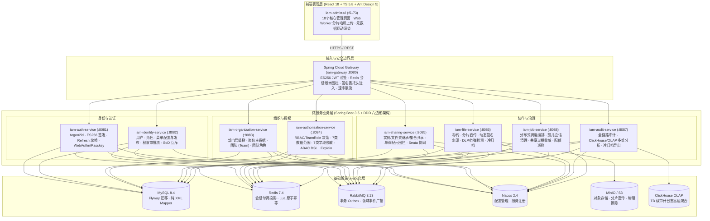

# Enterprise IAM & Dynamic Fine-Grained Authorization Platform

> **企业级多租户统一身份认证与动态细粒度授权平台**（Monorepo），全面贯彻 **SPEC 01 ~ SPEC 47** 规范体系（覆盖 V1.0 基线、V1.1 收敛、V1.2 增强及 V2.0 高级治理演进），遵循 **Permission As Data（权限即数据）**、**Default Deny（默认拒绝）**、**Fail-Closed（故障闭合）** 与 **多租户强隔离** 核心准则。

---

## 1. 项目定位与核心价值

Enterprise IAM 是一套面向现代化企业复杂组织架构与多云环境设计的全栈身份与权限平台，解决传统 RBAC 模型在多租户、矩阵式组织（部门/岗位/团队）、行级数据隔离、列级敏感脱敏、ABAC 动态规则及资源级跨租户共享下的治理瓶颈。

### 核心设计原则
1. **权限即数据（Permission As Data）**：前端界面绝不硬编码任何角色（如 `role === 'ADMIN'`）或静态权限字符，导航树、页面按钮操作集与表格列安全策略 100% 由服务端元数据引擎（`useServerMetadata`）动态派发，支持安全平滑降级。
2. **默认拒绝与故障闭合（Default Deny & Fail-Closed）**：授权决策引擎在策略未命中、投影纪元滞后（`expected_epoch > applied_epoch`）、Condition DSL 越界或下游安全依赖不可用时，均 Fail-Closed 阻断放行。
3. **业务主数据与授权模型严格解耦**：
   - **部门（Department）**：层级树主数据，支撑组织树构建与成员归属查询。
   - **岗位（Position）**：独立主数据，表征企业人事职位，杜绝与权限角色混淆。
   - **角色（Role / TeamRole）**：授权实体，用于权限集合承载与绑定。
4. **全生命周期可配置动态菜单**：支持目录、菜单、按钮三级建模，具备草稿与发布两阶段上线机制，一键下发全局生效。
5. **审批流真实落地执行**：权限审批引擎涵盖角色申请、团队角色申请、资源分享申请，审批通过后自动触发底层实体出站端口落库生效。
6. **100% MyBatis-Plus + XML 参数化绑定**：生产代码杜绝内联 SQL、注解 SQL 与字符串拼接，全量参数化查询防护 SQL 注入。
7. **全链路防精度丢失**：所有 64 位整型 ID 在 JSON 边界统一序列化为十进制字符串。

---

## 2. 系统全景架构图



---

## 3. 仓库代码结构

```text
enterprise-iam/
├── backend/                                   # 后端微服务 Reactor（Java 21 + Spring Boot 3.5）
│   ├── pom.xml                                # 后端根 POM
│   ├── iam-dependencies/                      # 统一版本依赖 BOM
│   ├── iam-framework/                         # 17 个通用 Starter 与核心基础设施库
│   │   ├── iam-common-core/                   # 领域上下文、TraceId、DataScope/FieldPolicy 核心模型
│   │   ├── iam-common-security/               # Argon2id、ES256、JWKS、签名委托上下文
│   │   ├── iam-common-mybatis/                # MyBatis-Plus 基础配置与纯 XML 规范集成
│   │   ├── iam-common-redis/                  # Redis 缓存与会话版本单调校验
│   │   ├── iam-common-mq/                     # RabbitMQ 事件发布与幂等消费者抽象
│   │   ├── iam-idempotent-spring-boot-starter/# Redis Lua 核心原子幂等组件
│   │   ├── iam-outbox-spring-boot-starter/    # 事务性 Outbox 领域事件分发器
│   │   └── ...                                # 审计、锁、数据权限、字段权限 Starter
│   ├── iam-gateway/                           # API 网关服务（:8080）
│   ├── iam-auth-service/                      # 认证中心服务（:8081）
│   ├── iam-identity-service/                  # 身份与用户/菜单/角色/审批服务（:8082）
│   ├── iam-organization-service/              # 组织架构/部门/岗位/团队服务（:8083）
│   ├── iam-authorization-service/             # 统一多维授权决策引擎（:8084）
│   ├── iam-sharing-service/                   # 资源跨主体细粒度共享服务（:8085）
│   ├── iam-file-service/                      # 企业级文件传输与数据防泄漏服务（:8086）
│   ├── iam-audit-service/                     # 统一安全审计服务（:8087）
│   └── iam-job-service/                       # 分布式调度中心（:8088）
├── frontend/iam-admin-ui/                     # 前端工程（React 18 + TS 5.8 + Vite 6 + AntD 5）
│   ├── src/
│   │   ├── api/                               # 严格与 OpenAPI 对齐的 HTTP 模块
│   │   ├── app/router/                        # 路由与动态加载机制
│   │   ├── constants/navigation.ts            # 本地保底 Navigation Schema 与图标映射
│   │   ├── hooks/useServerMetadata.ts         # 服务端驱动页面/字段元数据 Hook
│   │   └── pages/                             # 18 个核心业务管理页面
├── docs/                                      # 规格与工程文档
│   ├── spec/spec.md                           # SPEC 01 ~ SPEC 47 权威规划文档
│   ├── api/                                   # OpenAPI 3.1 接口契约与 ERROR-CODES.md
│   └── events/                                # AsyncAPI 3.1 领域事件定义
├── deploy/                                    # 部署与运维清单
│   ├── docker/compose/                        # Docker Compose 基础设施与全栈编排
│   ├── helm/enterprise-iam/                   # Kubernetes Helm Chart 与 Istio 服务网格清单
│   └── scripts/                               # Windows PowerShell 与 Linux Shell 启停自动化脚本
├── AGENTS.md                                  # AI Coding Agent 架构红线与开发规约
├── HANDOFF.md                                 # 全栈工程交付与交付物清单
└── ISSUE.md                                   # 架构裁决台账（D-1 ~ D-25）与开放决策清单
```

---

## 4. 核心功能特性矩阵

| 领域模块 | 业务功能 | 技术实现与规范红线 |
| :--- | :--- | :--- |
| **部门管理 (Department)** | 部门树结构、详情查看、部门信息编辑、停用/启用、防孤儿/防环检测、部门直属与下属成员查询 | 独立领域实体，[`OrganizationPersistenceMapper.xml`](file:///d:/release/specs/enterprise-iam/backend/iam-organization-service/src/main/resources/mapper/OrganizationPersistenceMapper.xml) 纯 XML 查询，支持有子节点与有成员防删校验。 |
| **岗位管理 (Position)** | 岗位主数据 CRUD、编码唯一性防重、排序号维护、启停控制、在用人员防删保护 | 物理表 `iam_position`，与角色解耦；[`PositionController`](file:///d:/release/specs/enterprise-iam/backend/iam-organization-service/src/main/java/com/enterprise/iam/organization/interfaces/http/PositionController.java) 提供完整生命周期管理。 |
| **用户与会话管理 (User)** | 分页检索（支持部门/岗位/状态复合过滤）、用户创建与资料更新、密码重置、账号启停、一键强制下线（Kick Sessions） | 扩充 `department_id` 与 `position_id` 外键，结合 Redis 单调递增会话版本号，停用或强退时即刻使全设备 Session 失效。 |
| **动态菜单配置 (Menu)** | 目录/菜单/按钮三级树形配置、路由组件映射、权限标识绑定、排序维护、草稿/已发布两阶段状态、一键全量生效 | 数据库表 `iam_menu`，[`GetNavigationSchemaUseCase`](file:///d:/release/specs/enterprise-iam/backend/iam-identity-service/src/main/java/com/enterprise/iam/identity/application/service/GetNavigationSchemaUseCase.java) 实时下发已发布菜单，前端无感刷新导航。 |
| **权限审批工作流 (Approval)** | 角色绑定、团队角色绑定、资源分享三种申请提交，审批通过/驳回，**审批通过后真实自动执行业务赋权** | [`PermissionApprovalUseCase`](file:///d:/release/specs/enterprise-iam/backend/iam-identity-service/src/main/java/com/enterprise/iam/identity/application/service/PermissionApprovalUseCase.java) 批准后联动出站端口完成角色落库与共享 ACL 生成。 |
| **认证与会话围栏 (Auth)** | Argon2id 密码散列、ES256 签名 `at+jwt` 令牌、256-bit Refresh Cookie 单向轮转、Passkey/WebAuthn 无密码登录 | 遵守 OAuth 2.1 规范与 RFC 6749，防重放家族式全量会话吊销，SignCount 克隆凭证检测。 |
| **多维授权引擎 (Authorization)** | RBAC + TeamRole 合并计算、7 类行级数据范围（本人/本团队/本级及下级组织等）SQL 谓词编译、7 类列级动态掩码、ABAC Condition DSL 求值、决策解释（Explain） | 内存限制深度 ≤ 8、Token ≤ 64 的 DSL Evaluator；安全失败闭合（Fail-Closed）；Explain 不泄露敏感谓词详情。 |
| **细粒度资源共享 (Sharing)** | 资源实例共享、文件夹继承共享（`FOLDER_INHERITED`）、资源集合打包（`COLLECTION`）、单调 Epoch 围栏、Seata 跨库协同 | 单调递增 `projection_epoch`，防止降级读脏数据；支持撤销与重分享（Reshare）防越权校验。 |
| **企业文件传输与 DLP (File)** | 前端 Web Worker 增量哈希秒传、分片直传（Multipart Presigned PUT）、断点续传、动态签名水印、压缩包炸弹检测、Glacier 冷归档 | 统一 S3 API 封装（MinIO），集成防篡改隐式与显式水印，扫描状态机异步流式审计。 |
| **安全审计与调度 (Audit/Job)** | 全链路操作审计与安全日志、ClickHouse 多维加速检索与冷导出；分布式定时作业调度、孤儿会话回收、配额巡检 | 分布式锁保障调度幂等，支持多维度按租户隔离的配额统计。 |

---

## 5. 快速启动与本地运行

### 5.1 环境基线
- **JDK**：Java 21 LTS
- **Build Tool**：Apache Maven 3.9+
- **Node.js**：Node.js 20 LTS（20.19+）及 npm 10+
- **Container**：Docker Desktop 或 Docker Engine 24+

### 5.2 启动基础设施容器
进入项目根目录，使用自动化脚本启动所需容器（MySQL 8.4、Redis 7.4、RabbitMQ 3.13、Nacos 2.4、MinIO）：

**Windows PowerShell**：
```powershell
# 1. 一键启动基础设施
.\deploy\scripts\start-infra.ps1

# 2. 等待容器健康检查完全就绪
.\deploy\scripts\wait-healthy.ps1
```

> **提示**：若宿主机存在端口冲突，可通过设置环境变量指定映射端口，如：
> `$env:MYSQL_PORT_MAPPING="127.0.0.1:3307:3306"; .\deploy\scripts\start-infra.ps1`

### 5.3 编译与运行后端微服务
在根目录下执行 Maven 命令：

```powershell
# 全模块编译与代码静态检查
mvn -f backend/pom.xml compile

# 运行单元测试与分层架构测试（ArchUnit）
mvn -f backend/pom.xml test

# 打包微服务应用 JAR
mvn -f backend/pom.xml package -DskipTests
```

可通过启动 `iam-gateway` 及各微服务的 Spring Boot Application 入口主类启动后端环境：
- 网关主类：[`GatewayApplication.java`](file:///d:/release/specs/enterprise-iam/backend/iam-gateway/src/main/java/com/enterprise/iam/gateway/GatewayApplication.java)（端口 `8080`）
- 认证主类：[`AuthApplication.java`](file:///d:/release/specs/enterprise-iam/backend/iam-auth-service/src/main/java/com/enterprise/iam/auth/AuthApplication.java)（端口 `8081`）
- 身份主类：[`IdentityApplication.java`](file:///d:/release/specs/enterprise-iam/backend/iam-identity-service/src/main/java/com/enterprise/iam/identity/IdentityApplication.java)（端口 `8082`）
- 组织主类：[`OrganizationApplication.java`](file:///d:/release/specs/enterprise-iam/backend/iam-organization-service/src/main/java/com/enterprise/iam/organization/OrganizationApplication.java)（端口 `8083`）
- 授权主类：[`AuthorizationApplication.java`](file:///d:/release/specs/enterprise-iam/backend/iam-authorization-service/src/main/java/com/enterprise/iam/authorization/AuthorizationApplication.java)（端口 `8084`）

### 5.4 启动与构建前端控制台
在 `frontend/iam-admin-ui` 目录下执行：

```powershell
# 1. 规范检查（ESLint 零告警标准）
npm -C frontend/iam-admin-ui run lint

# 2. 启动本地开发热更新服务器（默认 http://localhost:5173）
npm -C frontend/iam-admin-ui run dev

# 3. 生产静态资源构建（TypeScript 类型检查与 Vite 打包）
npm -C frontend/iam-admin-ui run build
```

---

## 6. 云原生与容器化部署（Kubernetes & Helm）

项目提供生产级 Helm Chart 与多地域（Multi-Region）容灾清单：

```bash
# 1. 部署单地域生产环境
helm upgrade --install enterprise-iam ./deploy/helm/enterprise-iam \
  -n enterprise-iam --create-namespace \
  -f ./deploy/helm/enterprise-iam/values.yaml

# 2. 启用 Istio 服务网格与双地域容灾部署
helm upgrade --install enterprise-iam ./deploy/helm/enterprise-iam \
  -n enterprise-iam \
  -f ./deploy/helm/enterprise-iam/values.yaml \
  -f ./deploy/helm/enterprise-iam/values-multi-region.yaml
```

---

## 7. 契约规范与工程导航

本项目遵循 Contract-First 理念，开发与维护前请务必参阅以下文档：

- 📖 **架构规格全览**：[`docs/spec/spec.md`](file:///d:/release/specs/enterprise-iam/docs/spec/spec.md)（SPEC 01 ~ SPEC 47，含 D-1 ~ D-25 裁决标准）
- 🛡️ **AI 协作红线**：[`AGENTS.md`](file:///d:/release/specs/enterprise-iam/AGENTS.md)（分层约束、持久化铁律、验证命令与代码规范）
- 📋 **交付运维手册**：[`HANDOFF.md`](file:///d:/release/specs/enterprise-iam/HANDOFF.md)（全栈验收清单、配置基线与运维排障）
- ⚠️ **决策与准入台账**：[`ISSUE.md`](file:///d:/release/specs/enterprise-iam/ISSUE.md)（开放决策寄存器 DEC-001 ~ DEC-014）
- 🌐 **HTTP 契约**：
  - [`openapi-code-phase-01.yaml`](file:///d:/release/specs/enterprise-iam/docs/api/openapi-code-phase-01.yaml) — 认证、租户、用户、菜单、角色与审批
  - [`openapi-code-phase-02-policy.yaml`](file:///d:/release/specs/enterprise-iam/docs/api/openapi-code-phase-02-policy.yaml) — 部门、岗位、团队、数据范围与字段策略
  - [`openapi-code-phase-03-sharing-file.yaml`](file:///d:/release/specs/enterprise-iam/docs/api/openapi-code-phase-03-sharing-file.yaml) — 资源共享、大文件分片传输与安全扫描
- 🚨 **标准化错误码**：[`ERROR-CODES.md`](file:///d:/release/specs/enterprise-iam/docs/api/ERROR-CODES.md)
