# Enterprise IAM & Dynamic Authorization Platform 权威架构与业务领域总体规格说明书 (SPEC 01 ~ SPEC 47 完整重构整合版)

> - **版本标识**：2.0.0-RELEASE (Enterprise Frozen Architecture Baseline)
> - **权威地位**：最高优先级统一架构规范（超越并整合 SPEC 01 ~ SPEC 46，收敛 D-1 ~ D-25 架构裁决与 DEC-001 ~ DEC-014 生产准入清单）
> - **核心架构准则**：Permission As Data · Default Deny · Fail Closed · Multi-Tenant Hard Isolation · Lossless 64-bit Decimal ID
> - **工程实施铁律**：100% MyBatis-Plus + XML 参数化绑定 · DDD 六边形架构分层 · 前端 UX Enforcement 元数据动态驱动

---

## 目录索引

[TOC]

- [第一部分 系统定位 架构准则与规范权威 (Architecture and Authority)](#第一部分-系统定位-架构准则与规范权威-architecture-and-authority)
  - [1.1 平台定位与设计哲学](#11-平台定位与设计哲学)
  - [1.2 规格权威优先级 (Authority Precedence)](#12-规格权威优先级-authority-precedence)
  - [1.3 八大微服务上下文职责与物理库归属矩阵](#13-八大微服务上下文职责与物理库归属矩阵)
  - [1.4 DDD 六边形架构分层铁律与纯 XML 持久化规约](#14-ddd-六边形架构分层铁律与纯-xml-持久化规约)
  - [1.5 PEP PDP PIP 分布式授权架构体系](#15-pep-pdp-pip-分布式授权架构体系)
  - [1.6 全局统一 API 响应契约与错误处理模型](#16-全局统一-api-响应契约与错误处理模型)
- [第二部分 身份认证 凭据与会话治理领域 (Identity, Authentication and Session)](#第二部分-身份认证-凭据与会话治理领域-identity-authentication-and-session)
  - [2.1 租户生命周期 状态机与原子引导 (Tenant Bootstrap)](#21-租户生命周期-状态机与原子引导-tenant-bootstrap)
  - [2.2 用户主数据模型与账号生命周期](#22-用户主数据模型与账号生命周期)
  - [2.3 现代化凭据核验体系 (Argon2id WebAuthn Passkey)](#23-现代化凭据核验体系-argon2id-webauthn-passkey)
  - [2.4 双令牌体系与安全轮换协议 (ES256 Token Refresh Cookie)](#24-双令牌体系与安全轮换协议-es256-token-refresh-cookie)
  - [2.5 Redis 单调递增会话围栏 (Session Version Fence) 与全端强退](#25-redis-单调递增会话围栏-session-version-fence-与全端强退)
  - [2.6 职责分离 (SoD) 静态与动态互斥矩阵](#26-职责分离-sod-静态与动态互斥矩阵)
  - [2.7 员工入职与离职端到端闭环流水线](#27-员工入职与离职端到端闭环流水线)
  - [2.8 全局在线会话看板与精细化会话强退治理](#28-全局在线会话看板与精细化会话强退治理)
  - [2.9 通用数据字典扩展管理 (Data Dictionary Master Data)](#29-通用数据字典扩展管理-data-dictionary-master-data)
- [第三部分 组织机构 部门与岗位主数据领域 (Organization, Department and Position Master Data)](#第三部分-组织机构-部门与岗位主数据领域-organization-department-and-position-master-data)
  - [3.1 组织机构与部门 (Department) 树形层级治理模型](#31-组织机构与部门-department-树形层级治理模型)
  - [3.2 组织闭包表 (Closure Table) 高性能树遍历与防环算法](#32-组织闭包表-closure-table-高性能树遍历与防环算法)
  - [3.3 独立岗位 (Position) 业务主数据模型与防删保护](#33-独立岗位-position-业务主数据模型与防删保护)
  - [3.4 团队 (Team) 与团队角色 (Team Role) 矩阵式协作授权](#34-团队-team-与团队角色-team-role-矩阵式协作授权)
  - [3.5 部门-岗位-人员三维模型与直属成员查询闭环](#35-部门-岗位-人员三维模型与直属成员查询闭环)
- [第四部分 动态菜单与功能权限发布领域 (Dynamic Menu and Server-Driven UI)](#第四部分-动态菜单与功能权限发布领域-dynamic-menu-and-server-driven-ui)
  - [4.1 目录 (DIRECTORY) 菜单 (MENU) 与按钮 (BUTTON) 三级元数据模型](#41-目录-directory-菜单-menu-与按钮-button-三级元数据模型)
  - [4.2 路由组件与权限标识 (Permission String) 绑定机制](#42-路由组件与权限标识-permission-string-绑定机制)
  - [4.3 草稿与发布两阶段状态机 (DRAFT to PUBLISHED)](#43-草稿与发布两阶段状态机-draft-to-published)
  - [4.4 服务端驱动前端表现层 (useServerMetadata 与平滑降级)](#44-服务端驱动前端表现层-useservermetadata-与平滑降级)
- [第五部分 权限审批流与业务执行闭环领域 (Approval and Real Action Execution)](#第五部分-权限审批流与业务执行闭环领域-approval-and-real-action-execution)
  - [5.1 权限申请类型与数据模型](#51-权限申请类型与数据模型)
  - [5.2 审批生命周期状态机](#52-审批生命周期状态机)
  - [5.3 审批批准后真实业务动作执行闭环](#53-审批批准后真实业务动作执行闭环)
- [第六部分 多维统一授权与决策引擎领域 (Unified Authorization and Decision Engine)](#第六部分-多维统一授权与决策引擎领域-unified-authorization-and-decision-engine)
  - [6.1 应用-服务-资源-操作 (Application-Service-Resource-Operation) 模型](#61-应用-服务-资源-操作-application-service-resource-operation-模型)
  - [6.2 RBAC 与 TeamRole 与 ShareACL 多轨合并决策流水线与算法伪代码](#62-rbac-与-teamrole-与-shareacl-多轨合并决策流水线与算法伪代码)
  - [6.3 统一授权决策流水线与 API 映射机制](#63-统一授权决策流水线与-api-映射机制)
  - [6.4 ABAC 策略与受限安全 Condition DSL 规约 (DEC-014)](#64-abac-策略与受限安全-condition-dsl-规约-dec-014)
  - [6.5 决策解释器 (Explain Engine 与数据脱敏推理追溯)](#65-决策解释器-explain-engine-与数据脱敏推理追溯)
- [第七部分 行级数据范围与列级字段安全领域 (Data Scope and Field Policy)](#第七部分-行级数据范围与列级字段安全领域-data-scope-and-field-policy)
  - [7.1 7 类行级数据范围模型与 AST 谓词生成模板](#71-7-类行级数据范围模型与-ast-谓词生成模板)
  - [7.2 数据范围 SQL 谓词编译与 MyBatis 拦截器防注入](#72-数据范围-sql-谓词编译与-mybatis-拦截器防注入)
  - [7.3 列级字段读写隐藏策略 (READ WRITE HIDE)](#73-列级字段读写隐藏策略-read-write-hide)
  - [7.4 字段动态脱敏引擎 (TypedMasker 7 类掩码算法)](#74-字段动态脱敏引擎-typedmasker-7-类掩码算法)
- [第八部分 细粒度资源跨主体共享领域 (Resource Sharing and ACL)](#第八部分-细粒度资源跨主体共享领域-resource-sharing-and-acl)
  - [8.1 共享范围与继承机制 (Instance Folder Collection)](#81-共享范围与继承机制-instance-folder-collection)
  - [8.2 共享权限边界校验与传递性重分享 (Reshare) 防越权](#82-共享权限边界校验与传递性重分享-reshare-防越权)
  - [8.3 跨服务投影纪元单调围栏 (Projection Epoch Fence)](#83-跨服务投影纪元单调围栏-projection-epoch-fence)
  - [8.4 Seata 分布式事务与跨库撤销最终一致性](#84-seata-分布式事务与跨库撤销最终一致性)
- [第九部分 企业文件传输与数据安全防泄漏领域 (Enterprise File and DLP)](#第九部分-企业文件传输与数据安全防泄漏领域-enterprise-file-and-dlp)
  - [9.1 前端 Web Worker 哈希秒传与 S3/MinIO 分片直传及 CAS 合并](#91-前端-web-worker-哈希秒传与-s3minio-分片直传及-cas-合并)
  - [9.2 动态防篡改可见与隐式数字指纹签名水印](#92-动态防篡改可见与隐式数字指纹签名水印)
  - [9.3 内容安全检查状态机 (DLP ZIP Bomb 病毒扫描 SPI)](#93-内容安全检查状态机-dlp-zip-bomb-病毒扫描-spi)
  - [9.4 存储生命周期 Glacier 冷归档与 S204 容灾恢复演练](#94-存储生命周期-glacier-冷归档与-s204-容灾恢复演练)
- [第十部分 物理数据库设计与 Flyway Schema 规格 (Physical Database Schema)](#第十部分-物理数据库设计与-flyway-schema-规格-physical-database-schema)
  - [10.1 数据库总体策略与基线规范](#101-数据库总体策略与基线规范)
  - [10.2 iam_auth 数据库核心表 DDL 与索引](#102-iam_auth-数据库核心表-ddl-与索引)
  - [10.3 iam_identity 数据库核心表 DDL 与索引](#103-iam_identity-数据库核心表-ddl-与索引)
  - [10.4 iam_organization 数据库核心表 DDL 与索引](#104-iam_organization-数据库核心表-ddl-与索引)
  - [10.5 iam_authorization 数据库核心表 DDL 与索引](#105-iam_authorization-数据库核心表-ddl-与索引)
  - [10.6 iam_sharing 数据库核心表 DDL 与索引](#106-iam_sharing-数据库核心表-ddl-与索引)
  - [10.7 iam_file 数据库核心表 DDL 与索引](#107-iam_file-数据库核心表-ddl-与索引)
  - [10.8 iam_audit 与 iam_job 数据库核心表 DDL 与索引](#108-iam_audit-与-iam_job-数据库核心表-ddl-与索引)
- [第十一部分 查询模型 仓储契约与 MyBatis-Plus XML 持久化架构 (Query Model and Repository)](#第十一部分-查询模型-仓储契约与-mybatis-plus-xml-持久化架构-query-model-and-repository)
  - [11.1 CQRS Lite 读写分离架构与模型映射](#111-cqrs-lite-读写分离架构与模型映射)
  - [11.2 仓储适配器模式 (Domain Port to Jdbc Repository)](#112-仓储适配器模式-domain-port-to-jdbc-repository)
  - [11.3 100% MyBatis-Plus XML Mapper 规约与参数化防注入](#113-100-mybatis-plus-xml-mapper-规约与参数化防注入)
  - [11.4 租户多租户隔离拦截器与物理逻辑双层防串包](#114-租户多租户隔离拦截器与物理逻辑双层防串包)
  - [11.5 深度分页防护与游标查询机制](#115-深度分页防护与游标查询机制)
- [第十二部分 应用服务 领域聚合与分布式一致性 (Domain Aggregate and Consistency)](#第十二部分-应用服务-领域聚合与分布式一致性-domain-aggregate-and-consistency)
  - [12.1 核心领域聚合根与值对象清单](#121-核心领域聚合根与值对象清单)
  - [12.2 入站命令 (Command) 与查询 (Query) 规范与入参校验](#122-入站命令-command-与查询-query-规范与入参校验)
  - [12.3 Transactional Outbox 事务边界与投递机制](#123-transactional-outbox-事务边界与投递机制)
  - [12.4 Redis Lua 原子租约幂等机制与状态机](#124-redis-lua-原子租约幂等机制与状态机)
  - [12.5 跨服务领域事件全目录 (Domain Events Schema and Payloads)](#125-跨服务领域事件全目录-domain-events-schema-and-payloads)
- [第十三部分 安全威胁模型与 STRIDE 防御矩阵 (Threat Modeling and STRIDE)](#第十三部分-安全威胁模型与-stride-防御矩阵-threat-modeling-and-stride)
  - [13.1 STRIDE 威胁矩阵与防御落地清单](#131-stride-威胁矩阵与防御落地清单)
  - [13.2 20 大安全滥用案例 (Abuse Cases) 与系统级防范策略](#132-20-大安全滥用案例-abuse-cases-与系统级防范策略)
  - [13.3 零信任内部服务互信与网关签名委托头机制](#133-零信任内部服务互信与网关签名委托头机制)
- [第十四部分 统一安全审计 可观测性与生产运营 (Observability, Audit and Operations)](#第十四部分-统一安全审计-可观测性与生产运营-observability-audit-and-operations)
  - [14.1 全链路安全审计模型与 MDC TraceId 贯通](#141-全链路安全审计模型与-mdc-traceid-贯通)
  - [14.2 ClickHouse/OLAP 高速聚合与审计冷归档导出](#142-clickhouseolap-高速聚合与审计冷归档导出)
  - [14.3 分布式调度中心 (iam-job-service) 定时任务全量清单](#143-分布式调度中心-iam-job-service-定时任务全量清单)
  - [14.4 生产 SLO 指标体系与容量规划](#144-生产-slo-指标体系与容量规划)
  - [14.5 基础中间件 Docker Compose 运行时部署规格与编排架构](#145-基础中间件-docker-compose-运行时部署规格与编排架构)
- [第十五部分 架构裁决台账与开放决策寄存器 (Architecture Decisions Register and Gates)](#第十五部分-架构裁决台账与开放决策寄存器-architecture-decisions-register-and-gates)
  - [15.1 D-1 至 D-25 架构裁决全面拆解与执行标准](#151-d-1-至-d-25-架构裁决全面拆解与执行标准)
  - [15.2 DEC-001 至 DEC-014 生产准入清单与 Fail-Closed 默认安全值](#152-dec-001-至-dec-014-生产准入清单与-fail-closed-默认安全值)

---

## 第一部分 系统定位 架构准则与规范权威 (Architecture and Authority)

### 1.1 平台定位与设计哲学

Enterprise IAM & Dynamic Authorization Platform 专为大型复杂企业组织、矩阵式业务协同、多租户 SaaS 及多云微服务环境设计。平台摒弃“在业务代码中写死硬编码角色或权限字符串”的传统粗放模式，提出并贯彻 **Permission As Data（权限即数据）** 现代化授权理念。

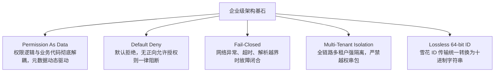

#### 核心安全准则详解

1. **Permission As Data, Not Permission As Code**：
   - 生产业务代码中严禁出现 `@PreAuthorize("hasRole('ADMIN')")`、`hasAuthority("user:update")`、`if (user.isAdmin)` 等字面量或硬编码逻辑。
   - 所有页面按钮、菜单路由、表格数据列读写掩码、数据查询过滤均通过运行时元数据（`Resource`、`Operation`、`Role`、`TeamRole`、`DataScope`、`FieldPolicy`、`ABAC Policy`）统一驱动。
   - 业务微服务仅需嵌入轻量级 PEP Starter，通过标准元数据键触发鉴权，业务代码只关心业务处理，彻底解耦权限规则与业务发布周期。
2. **Default Deny & Fail-Closed（默认拒绝与故障闭合）**：
   - 系统决策引擎在“无匹配授权”、“跨服务投影纪元落后”、“Condition DSL 解析错误或超限”、“外部安全组件宕机”时，必须无条件执行 Fail-Closed 阻断，返回 `DENY` 或 `503 Service Unavailable`，绝对禁止降级放行。
   - 脱敏策略在格式畸形、配置损坏或源文本不足以切分时，一律回退为全掩码 `"***"`，绝不泄露原始敏感明文。
3. **主数据解耦**：
   - **部门（Department）**：行政隶属树形主数据，支撑组织树构建与成员归属查询。
   - **岗位（Position）**：业务职位主数据，与角色彻底解耦，杜绝混淆。
   - **角色（Role / TeamRole）**：授权主体，仅用于权限承载与授权绑定。
4. **全链路防精度丢失（Lossless 64-bit Decimal ID）**：
   - 所有 64 位大整数 ID（如 Snowflake 生成的 `userId`, `tenantId`, `roleId`, `shareId`, `fileId` 等）在对外 HTTP JSON 传输时一律序列化为十进制字符串（正则：`^[1-9][0-9]{0,18}$`），彻底杜绝前端 JavaScript `Number.MAX_SAFE_INTEGER`（2⁵³ - 1）引起的精度截断风险。
   - 仅纯数值控制字段（如版本号 `version`, `permissionVersion`, `projectionEpoch` 或时效秒数 `expiresIn`）显式标注 `@NumericLong` 保留 JSON 数值类型。

---

### 1.2 规格权威优先级 (Authority Precedence)

当不同阶段的文档、历史设计说明或代码实现存在表述冲突时，所有模块设计、代码编写与验收测试严格遵循以下权威裁决优先级（由高至低）：

```text
SPEC 47 (一致性修订与 D-1 ~ D-25 收敛裁决)
  > SPEC 46 (事务性登录会话与令牌签发冻结)
  > SPEC 45 (会话投影事务性 Outbox 冻结)
  > SPEC 44 (HTTPS JWKS 与 Redis 会话投影适配器冻结)
  > SPEC 43 (网关访问认证与会话围栏冻结)
  > SPEC 42 (委托密钥轮转与服务装配冻结)
  > SPEC 41 (认证与委托密码学实现冻结)
  > SPEC 40 (Phase-01 安全核心实现冻结)
  > SPEC 39 (后端构建与 Reactor 基础冻结)
  > SPEC 38 (核心授权机器契约冻结)
  > SPEC 37 (Code-Ready 实现契约冻结)
  > SPEC 36 (一致性审查与准入冻结)
  > SPEC 24 ~ 35 (各专业领域详细设计与冻结)
  > SPEC 01 ~ 23 (早期概念基线与规划)
```

- **开放决策寄存器（`DEC-001`** **~** **`DEC-014`）**：在生产环境未接入外部 HSM/KMS 或定制阈值前，系统代码必须严格保持 **Fail-Closed 安全默认值**。

---

### 1.3 八大微服务上下文职责与物理库归属矩阵

系统严格按领域驱动设计（DDD）划分为八大独立微服务上下文（Bounded Context），各服务独占物理数据库与 Schema，杜绝跨库直连与跨库 JOIN：

| 微服务模块                           | 物理库名                | 核心上下文职责                                                                                             | 核心实体 / 聚合根                                                               | 依赖边界与通讯模式                       |
| :------------------------------ | :------------------ | :-------------------------------------------------------------------------------------------------- | :----------------------------------------------------------------------- | :------------------------------ |
| **`iam-gateway`**               | 无 (无状态)             | 统一接入网关、ES256 令牌验签、Redis 会话版本单调围栏拦截、租户与主体签名委托头注入、网络速率限流。                                             | 无状态路由网关                                                                  | 外部流量入口；与 Redis 交互；向后端服务路由并注入委托头 |
| **`iam-auth-service`**          | iam_auth`          | 凭据管理、Argon2id 密码散列、OAuth 2.1 令牌签发、HTTPS JWKS 密钥轮转、Refresh Token 家族式轮换与盗用检测、WebAuthn/Passkey。        | `Credential`, `AuthSession`, `RefreshToken`, `WebAuthn`                  | 监听凭据重置事件；发布会话创建/吊销事件至 Outbox    |
| **`iam-identity-service`**      | iam_identity`      | 租户生命周期、用户主数据管理（含部门/岗位归属及强退会话）、角色定义、动态菜单配置与发布、职责分离 (SoD) 校验、权限审批流真实业务执行。                             | `Tenant`, `User`, `Role`, `Menu`, `PermissionApproval`                   | 租户与用户事实源；发布用户停用、角色变更事件          |
| **`iam-organization-service`**  | iam_organization`  | 组织机构与部门（Department）层级树治理、独立岗位（Position）主数据维护、部门成员关联检索、团队（Team）与团队角色（TeamRole）协作。                    | `Organization`, `Position`, `Team`, `TeamRole`, `Closure`                | 组织人事事实源；闭包表维护；向授权服务提供团队关系       |
| **`iam-authorization-service`** | iam_authorization` | 统一授权决策引擎（RBAC + TeamRole + ShareACL）、7 类行级数据范围编译、7 类列级动态掩码脱敏与写保护、ABAC 条件 DSL 内存求值器、决策解释器 (Explain)。 | `Resource`, `Operation`, `Policy`, `DataScope`, `FieldPolicy`, `Explain` | 授权核心 PDP；消费共享与权限事件物化投影；提供决策 API |
| **`iam-sharing-service`**       | iam_sharing`       | 细粒度资源实例共享、文件夹级联继承共享、资源集合共享、单调纪元围栏（Projection Epoch）、跨库 Seata 协同。                                    | `ShareAcl`, `ShareInheritance`, `ShareCollection`                        | 共享事实源；发布共享授予/撤销事件并推进 Epoch      |
| **`iam-file-service`**          | iam_file`          | 企业级大文件秒传、分片直传、断点续传、CAS 物理合并、动态签名水印、压缩包炸弹与 DLP 扫描、Glacier 冷归档、S204 容灾。                               | `LogicalFile`, `PhysicalObject`, `UploadSession`, `ScanResult`           | 直传 S3/MinIO；触发异步扫描；提供水印预览与流式下载  |
| **`iam-audit-service`**         | iam_audit`         | 全链路安全与操作审计日志归集、ClickHouse/OLAP 多维高速检索、冷归档导出任务编排。                                                    | `AuditLog`, `SecurityEvent`, `ExportTask`                                | 异步消费全域审计事件；提供多维查询与报表分析          |
| **`iam-job-service`**           | iam_job`           | 分布式作业调度、孤儿会话回收、共享过期对账收敛、存储配额定期巡检与一致性校准。                                                             | `ScheduledJob`, `JobExecutionLog`                                        | 独立调度服务；定时调度各微服务维护任务             |

---

### 1.4 DDD 六边形架构分层铁律与纯 XML 持久化规约

#### 依赖倒置与分层隔离铁律

每个微服务严格按 DDD 六边形架构划分为四个顶层包：

```text
com.enterprise.iam.<service>
├── domain          # 纯 Java 领域层：聚合根、实体、值对象、领域服务（如 ConditionDslEvaluator）
├── application     # 应用服务层：*UseCase、入站命令/查询、出站端口接口 (port.out.*)
├── infrastructure  # 基础设施层：MyBatis-Plus Mapper、持久化行对象 (*Row)、仓储适配器 (Jdbc*Repository)、MQ/Redis 适配器
└── interfaces      # 接口契约层：REST Controller、请求/响应 DTO、输入参数校验
```

- **领域层（`domain`）红线**：
  - 必须保持 100% 纯 Java POJO 实现。
  - **严禁**导入 `org.springframework.*`、`com.baomidou.mybatisplus.*`、`java.sql.*` 或 `javax.sql.*`。
  - 保持无外部依赖、高度可独立单测与逻辑自闭合。
- **应用层（`application`）红线**：
  - 仅依赖领域模型和自身定义的出站端口（`port.out.*`）。
  - **严禁**直接耦合基础设施层实现类（如 `Jdbc*Repository`）、MyBatis Mapper 或 Spring MVC 注解。
- **接口层（`interfaces`）红线**：
  - 严格调用应用层 UseCase。
  - **严禁**越过应用层直接操作 Mapper 或 Repository 仓储实现。

#### 持久层铁律（100% MyBatis-Plus + 纯 XML 集中管理）

根据 SPEC 47 §5 与架构红线要求：

1. **绝对禁止内联与注解 SQL**：
   - 生产代码中**严禁**使用 Spring `JdbcTemplate`、`NamedParameterJdbcTemplate`、原生 `Connection` 以及 MyBatis `@Select` / `@Insert` / `@Update` / `@Delete` 注解。
2. **纯 XML 集中管理**：
   - 所有 SQL 集中存放在各模块 `src/main/resources/mapper/**/*.xml` 中，与 `infrastructure.persistence.mapper.*Mapper` 接口方法一一同名映射。
3. **参数化防注入绑定**：
   - XML SQL 中一律使用 `#{...}` 进行参数绑定，**严禁**使用 `${...}` 字符串拼接。
4. **Flyway 版本化迁移**：
   - 表结构及数据约束变更必须通过对应微服务的 `src/main/resources/db/migration/V<N>__*.sql` 脚本交付，严禁直接篡改历史迁移文件。

---

### 1.5 PEP PDP PIP 分布式授权架构体系

平台构建标准 XACML 分布式授权模型：

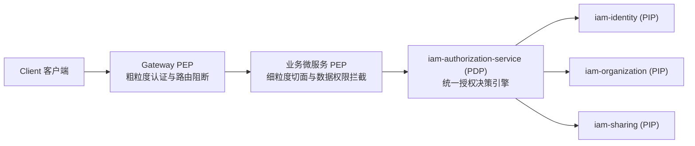

- **Gateway PEP**：拦截无有效 Token、Token 已过期、租户处于非活动状态或被会话版本围栏命中的恶意流量。
- **Business PEP**：在业务微服务入口根据 `@PreAuthorize` 替代方案——动态方法注解 `@RequirePermission(resource="...", operation="...")`，向 PDP 发起鉴权并提取 Obligations。
- **PDP (Authorization Service)**：综合 RBAC 全局角色、TeamRole 团队角色、ShareACL 共享规则与 ABAC Condition DSL，执行单次判定，毫秒级响应决策。

---

### 1.6 全局统一 API 响应契约与错误处理模型

平台所有对外暴露及内部通信的 HTTP REST API 一律遵循统一响应封包与错误码规范：

#### 统一成功响应结构

```json
{
  "success": true,
  "code": "OK",
  "message": "Operation executed successfully",
  "data": { ... },
  "traceId": "trace-819283719283",
  "timestamp": "2026-10-24T22:30:00.123Z"
}
```

#### 统一异常响应结构

```json
{
  "success": false,
  "code": "IAM_AUTH_CREDENTIAL_INVALID",
  "message": "Invalid username or password",
  "errorDetails": [
    { "field": "password", "message": "Password hash verification failed" }
  ],
  "traceId": "trace-819283719283",
  "timestamp": "2026-10-24T22:30:00.123Z"
}
```

#### 核心 HTTP 状态码映射标准

- `200 OK`：读写操作成功执行；
- `400 Bad Request`：入参 Schema 校验失败（如正则不符、缺少必要字段）；
- `401 Unauthorized`：未登录、Token 无效、Token 过期或被会话版本围栏强退；
- `403 Forbidden`：权限不足（无正向 Grant、ABAC 条件未满足、SoD 冲突）；
- `404 Not Found`：目标资源实体不存在；
- `409 Conflict`：业务唯一键冲突（如用户名已存在、并发编辑乐观锁冲突、岗位在用不可删）；
- `422 Unprocessable Entity`：业务逻辑校验违背（如组织层级成环、父节点非法）；
- `423 Locked`：文件扫描发现病毒或恶意威胁已被安全锁定；
- `503 Service Unavailable`：投影纪元落后（Fail-Closed 拒绝脏读放行）或关键安全依赖宕机。

> [🔝 回到目录索引](#目录索引)

---

## 第二部分 身份认证 凭据与会话治理领域 (Identity, Authentication and Session)

### 2.1 租户生命周期 状态机与原子引导 (Tenant Bootstrap)

租户是 Enterprise IAM 的顶级安全边界与多租户硬隔离容器。

#### 租户状态机

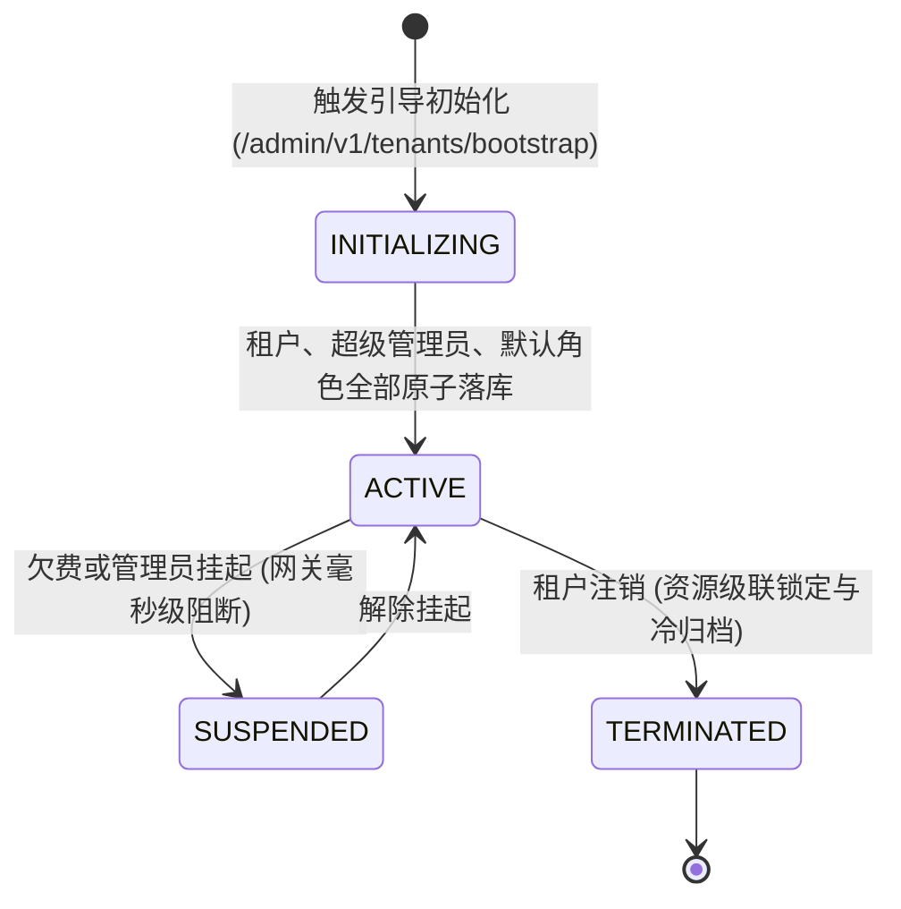

#### 引导初始化流程 (`/admin/v1/tenants/bootstrap`)

1. **幂等控制**：强制请求携带 `Idempotency-Key`。
2. **本地原子事务**：
   - 插入 `iam_tenant`（状态为 `ACTIVE`）；
   - 创建根用户记录并初始化超级管理员凭据；
   - 写入系统初始内置角色与初始系统权限绑定；
   - 写入 Outbox 记录，生成 `TenantBootstrappedEvent` 广播至 RabbitMQ，下游自动分配初始存储配额与审计空间。
3. **租户多租户隔离不变量**：
   - 跨租户数据访问必须经过网关与 MyBatis 租户拦截器，严禁使用非当前租户的 `tenant_id` 执行数据库操作；
   - 租户编码 `tenant_code` 必须符合小写正则 `^[a-z][a-z0-9-]{2,63}$`。

---

### 2.2 用户主数据模型与账号生命周期

#### 物理设计与字段规格（表 `iam_user`）

- `id` (BIGINT)：64 位雪花算法唯一标识。
- `tenant_id` (BIGINT)：租户 ID。
- `username` (VARCHAR)：租户内唯一系统登录名（3-64 位小写字母/数字/下划线）。
- `real_name` (VARCHAR)：用户真实姓名。
- `email` (VARCHAR)：工作邮箱（格式校验）。
- `phone` (VARCHAR)：手机号（E.164 或 11 位国内格式）。
- `department_id` (BIGINT)：归属部门 ID（外键关联 iam_organization.id`）。
- `position_id` (BIGINT)：担任岗位 ID（外键关联 `iam_position.id`）。
- `status` (VARCHAR)：`ACTIVE`（启用）、`DISABLED`（停用）、`LOCKED`（锁定）。
- `version` (INT)：乐观锁版本号。

#### 账号状态机与会话生命周期联动

- 当管理员调用 `/admin/v1/users/{userId}/disable` 停用账号时，系统在单事务中执行：
  1. 更新 `iam_user.status = 'DISABLED'` 并自增 `version`；
  2. 触发会话吊销端口，更新 Redis 中该用户的 `session_version = session_version + 1`；
  3. 即刻使该用户在所有终端设备持有的 Access Token 失效，网关拦截并返回 `401 IAM_AUTH_USER_DISABLED`。
- 账号启用端点 `/admin/v1/users/{userId}/enable` 更新状态为 `ACTIVE`，允许发起全新登录认证。

---

### 2.3 现代化凭据核验体系 (Argon2id WebAuthn Passkey)

#### Argon2id 密码哈希基线 (RFC 9106)

系统采用 RFC 9106 推荐的 Argon2id 算法存储密码散列值：

- **内存消耗（Memory Cost）**：`65536 KiB`（64 MB）。
- **迭代次数（Iterations / Time Cost）**：`3`。
- **并行线程（Parallelism）**：`1`。
- **盐值（Salt）**：16 字节高熵 CSPRNG 随机数。
- **哈希输出长度**：32 字节（256 位）。
- 格式规范：`$argon2id$v=19$m=65536,t=3,p=1$<salt>$<hash>`。

#### WebAuthn / Passkey 凭据与克隆检测

- 支持基于 FIDO2 / WebAuthn 标准的硬件安全密钥（YubiKey 等）与生物识别（Touch ID / Windows Hello）登录。
- **防克隆重放机制**：数据库单调记录 `sign_count`。认证核验时，客户端上报的计数值必须严格大于数据库存储值；若小于或等于原值，判定为硬件凭据被物理克隆，系统立即将该凭证置为 `REVOKED`，拒绝登录并向管理员告警。

---

### 2.4 双令牌体系与安全轮换协议 (ES256 Token Refresh Cookie)

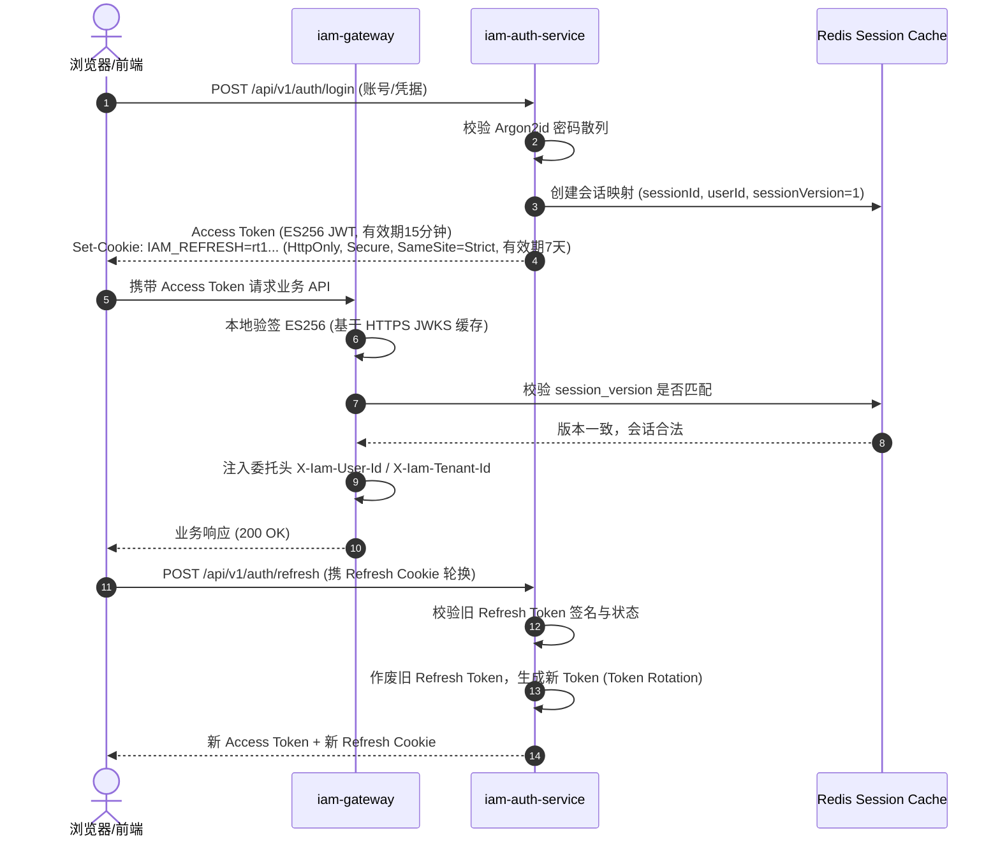

1. **Access Token (ES256)**：
   - 寿命：15 分钟短周期；
   - 算法：`ES256`（ECDSA P-256 + SHA-256）；
   - Payload 包含：`sub` (userId), `tenant_id`, `session_id`, `session_version`, `exp`, `iat`。
   - 公钥通过网关及微服务从 `iam-auth-service` 的 `/.well-known/jwks.json` 定期拉取并本地缓存（90 天密钥轮转，7 天宽限期）。
2. **Refresh Token 家族式轮换与盗用检测**：
   - 格式：256 位安全随机串；存储于 HttpOnly、Secure、SameSite=Strict Cookie 中，严禁暴露给前端 JavaScript 读取；
   - 采用严格单次消费（Single-Use）轮换机制；
   - 若系统检测到一个已被消费过的 Refresh Token 被再次提交，判定发生令牌盗用（Token Theft），系统即刻撤销该会话家族（Session Family）下的所有有效令牌与活跃 Session。

---

### 2.5 Redis 单调递增会话围栏 (Session Version Fence) 与全端强退

为实现无状态 JWT 的秒级吊销，引入 Redis 单调递增会话围栏：

- **Redis 键设计**：`iam:session:ver:{tenantId}:{userId}` -> `current_version` (INT)。
- **网关阻断逻辑**：> **会话有效性判定规则**：`Token.session_version < Redis.current_version` ==> `REJECT (401 IAM_AUTH_SESSION_REVOKED)`
- **全端强退接口（`/admin/v1/users/{userId}/kick`）**：
  管理员触发强退时，调用 Redis `INCR` 递增该键，使得该用户在 PC、手机、平板上的所有持有旧版 JWT 的会话在下一次请求网关时全部瞬时失效。

---

### 2.6 职责分离 (SoD) 静态与动态互斥矩阵

- **静态职责分离（Static SoD）**：在角色配置与授权绑定时，禁止同一用户同时持有互斥角色（如“会计”与“出纳”、“开发工程师”与“生产运维工程师”）。
- **动态职责分离（Dynamic SoD）**：在审批流与单笔交易场景中，单据的申请人禁止担任该单据的审批人，单据初审人禁止担任终审人，系统自动校验并阻断越权。

---

### 2.7 员工入职与离职端到端闭环流水线

#### 员工入职全流程 (Onboarding)

1. HR/管理员在控制台调用 `/admin/v1/users` 创建用户，录入真实姓名、部门（Department）、岗位（Position）及初始角色；
2. 系统生成初始凭据，写入 `iam_user`，并通过事务 Outbox 投递 `UserCreatedEvent`；
3. 员工首次登录，强制修改初始密码，密码哈希通过 Argon2id 加密持久化；
4. 颁发双令牌，建立活跃登录会话。

#### 员工离职全流程 (Offboarding)

1. 管理员在控制台调用 `/admin/v1/users/{userId}/disable`；
2. 用户主数据状态置为 `DISABLED`；
3. Redis `session_version` 立即自增，网关秒级阻断所有旧令牌；
4. 员工所持有的所有团队角色和资源共享进入级联清理或冻结队列；
5. 生成 `UserDisabledEvent` 广播全网，审计中心记录完整离职溯源日志。

---

### 2.8 全局在线会话看板与精细化会话强退治理

在多租户分布式架构中，除用户维度整体踢出（`POST /admin/v1/users/{userId}/sessions/kick`）外，系统提供了全局在线登录会话看板与单会话强退能力：

1. **在线会话全息看板 (`GET /admin/v1/sessions`)**：
   - 支持按租户隔离分页检索全量登录会话（支持 `userId` 与 `status` 过滤）；
   - 展示会话生命周期属性：会话 ID（`sessionId`）、用户 ID（`userId`）、客户端环境（`deviceType`）、最近访问时间（`lastAccessAt`）、绝对过期时间（`absoluteExpireAt`）及状态（`ACTIVE`、`REVOKED`、`EXPIRED`）。
2. **精准会话强退 (`POST /admin/v1/sessions/{sessionId}/revoke`)**：
   - 管理员可针对异常 IP、可疑设备或单一失窃会话进行即时强制下线；
   - 强退流水线：
     1. 原子更新 `iam_login_session` 状态为 `REVOKED`，记录 `revoked_at` 与 `revoke_reason`，并递增 `session_version`；
     2. 同步撤销关联于该会话的所有轮换 Refresh Token；
     3. 触发 Redis 会话投影更新与网关会话围栏（Session Version Fence）阻断，使该会话的旧 Access Token 立即失效返回 `401 Unauthorized`。

---

### 2.9 通用数据字典扩展管理 (Data Dictionary Master Data)

为满足企业多租户业务系统对主数据枚举、状态标签与业务分类的可配置化需求，身份服务提供通用数据字典扩展模块（Data Dictionary Module）：

1. **字典分类模型 (`iam_dict_type`)**：
   - 维护业务字典类型（如性别 `sys_user_sex`、文件安全等级 `file_security_level`、审批策略模式等）；
   - 支持租户隔离、唯一编码约束（`uk_dict_type`）、逻辑删除（`delete_marker`）与启用/停用状态控制；
   - 管理端点：`GET /admin/v1/dicts/types`、`POST /admin/v1/dicts/types`、`PUT /admin/v1/dicts/types/{id}`、`DELETE /admin/v1/dicts/types/{id}`。
2. **字典键值项模型 (`iam_dict_data`)**：
   - 维护各字典分类下的具体键值对（`dict_label`、`dict_value`、`sort_order`、`is_default`）；
   - 支持表现层样式属性绑定（`css_tag`，如 `success`、`processing`、`warning`、`error`），前端统一通过 AntD Tag 渲染；
   - 提供按字典类型快速检索活跃选项端点（`GET /admin/v1/dicts/data/type/{dictType}`），为全系统下拉选择框与表格列标签提供统一元数据驱动。

> [🔝 回到目录索引](#目录索引)

---

## 第三部分 组织机构 部门与岗位主数据领域 (Organization, Department and Position Master Data)

### 3.1 组织机构与部门 (Department) 树形层级治理模型

组织机构与部门构成企业行政管理的主骨架：

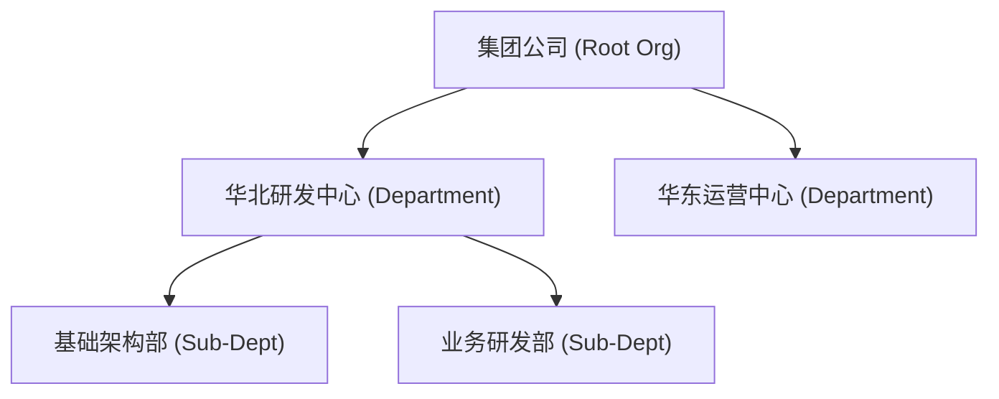

#### 数据库物理设计（iam_organization` 与 `iam_org_closure`）

- iam_organization`：存储部门节点属性（`id`, `tenant_id`, `parent_id`, `org_code`, `org_name`, `sort_order`, `status`, `version`）。
- 支持部门的创建、修改、启用、停用及树形查询。
- **停用级联约束**：当父部门停用时，下级所有子部门及归属人员的行政有效性受到约束。

---

### 3.2 组织闭包表 (Closure Table) 高性能树遍历与防环算法

闭包表存储任意两节点之间的层级深度距离，支撑极速无限级子树展开与跨层级过滤：

- `ancestor_id` (BIGINT)：祖先节点 ID；
- `descendant_id` (BIGINT)：后代节点 ID；
- `distance` (INT)：层级距离（自身到自身距离为 0）。

#### 极速展开子树与向上寻根

- 查询指定部门的所有子孙部门（包含自身）：
  ```sql
  SELECT descendant_id FROM iam_org_closure WHERE ancestor_id = #{deptId}
  ```
- 查询指定部门的所有上级祖先路径：
  ```sql
  SELECT ancestor_id FROM iam_org_closure WHERE descendant_id = #{deptId} ORDER BY distance DESC
  ```

#### 防环校验与防孤儿算法

- 当修改部门的 `parent_id` 时，系统必须执行闭包检索：> **层级防环约束**：`target_parent_id ∈ Descendants(current_org_id)` ==> 阻断移动并抛出 `422 IAM_ORG_HIERARCHY_CYCLE`
- 严禁将部门移动至自身或其子孙节点下，杜绝形成逻辑孤岛环路。

---

### 3.3 独立岗位 (Position) 业务主数据模型与防删保护

岗位（Position）是独立于权限角色的业务职位实体（表 `iam_position`）：

- **设计铁律**：严禁将“岗位”偷换为“角色”或“团队”。岗位是人员行政名册的业务职位属性，角色是权限系统的集合。
- **物理结构**：`id`, `tenant_id`, `code` (如 `TECH_LEAD`), `name` (如“技术组长”), `sort_order`, `status` (`ACTIVE`/`DISABLED`), `created_at`, `updated_at`。
- **防删保护**：当尝试物理删除岗位时，系统必须统计在用人员数：> **在用防删保护约束**：`Count(users where position_id = targetId) > 0` ==> 阻断删除并返回 `409 IAM_POSITION_IN_USE`

---

### 3.4 团队 (Team) 与团队角色 (Team Role) 矩阵式协作授权

团队用于打破传统科层制部门界限，支持敏捷项目、虚拟工作组协同：

- 团队成员可来自不同部门；
- 团队内定义专用的**团队角色（Team Role）**（如“项目负责人”、“外部观察员”）；
- **权限时效性与边界收敛**：团队角色赋予的权限严格受限于所属团队范围；一旦用户从团队中移除，其附随的全部团队角色与共享权限立即自动回收。

---

### 3.5 部门-岗位-人员三维模型与直属成员查询闭环

```text
       ┌────────────────────────┐
       │ Department 部门主数据  │
       └───────────┬────────────┘
                   │ 1:N 归属
                   ▼
       ┌────────────────────────┐         1:N 任职 ┌────────────────────────┐
       │   User 人员主数据      │ ◄────────────────┤  Position 岗位主数据   │
       └────────────────────────┘                  └────────────────────────┘
```

- 提供标准端点 `/admin/v1/organizations/{id}/members`，一键实时拉取属于该部门的所有成员信息（用户 ID、真实姓名、用户名、分配的岗位名称、邮箱、手机号及在职状态），形成企业人事治理闭环。

> [🔝 回到目录索引](#目录索引)

---

## 第四部分 动态菜单与功能权限发布领域 (Dynamic Menu and Server-Driven UI)

### 4.1 目录 (DIRECTORY) 菜单 (MENU) 与按钮 (BUTTON) 三级元数据模型

物理表 `iam_menu` 支撑企业管理系统的动态菜单与权限配置体系：


- **DIRECTORY（目录）**：一级/二级分组导航，拥有路径前缀与菜单图标，不绑定视图组件。
- **MENU（菜单）**：承载实际业务操作视图，绑定前端组件路径（如 `identity/UsersPage`）与路由（如 `/identity/users`）。
- **BUTTON（按钮）**：挂载在菜单下的操作级权限节点，绑定原子权限标识（如 `user:create`, `user:kick`）。

---

### 4.2 路由组件与权限标识 (Permission String) 绑定机制

- `code`：唯一菜单识别码（如 `identity-users`）。
- `title`：国际化或多语言显示标题（如“用户管理”）。
- `path`：前端路由访问路径（如 `/identity/users`）。
- `component`：前端懒加载视图组件路径（如 `identity/UsersPage`）。
- `icon`：Ant Design 标准图标名称。
- `permission`：后端资源操作映射的权限字符（如 `identity:user:list`）。
- `sort_order`：菜单树同层级排序权重值。

---

### 4.3 草稿与发布两阶段状态机 (DRAFT to PUBLISHED)

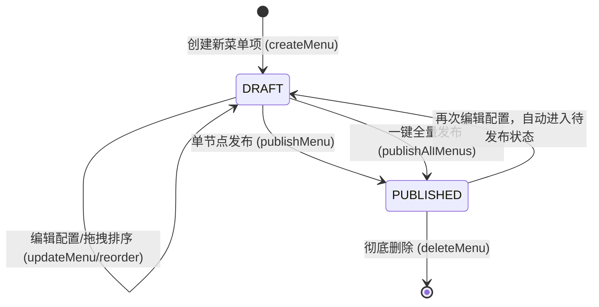

- **隔离性保障**：管理员对菜单的调整在未发布前始终保持为 `DRAFT` 状态；只有点击“发布”后，状态推进为 `PUBLISHED`，生产端用户拉取导航配置时方可实时生效。

---

### 4.4 服务端驱动前端表现层 (useServerMetadata 与平滑降级)

- 前端初始化与路由导航严格调用 `/admin/v1/navigation/schema` 获取已发布的活动菜单树。
- **页面操作鉴权**：页面通过 `usePageSchema(pageKey)` 动态获取服务端授权的可操作按钮集。若服务端离线或降级，前端执行**安全平滑降级**保障用户界面基本可用，而后端网关与微服务执行严密鉴权保证安全边界。

> [🔝 回到目录索引](#目录索引)

---

## 第五部分 权限审批流与业务执行闭环领域 (Approval and Real Action Execution)

### 5.1 权限申请类型与数据模型

权限审批流（物理表 `iam_permission_approval`）提供企业合规的权限申请机制，支持三种标准申请：

| 申请类型 (`request_type`) | 业务目标          | 目标标识 (`target_id`)           | 审批执行目标表                | 审批通过真实动作                  |
| :-------------------- | :------------ | :--------------------------- | :--------------------- | :------------------------ |
| `ROLE_ASSIGN`         | 申请租户全局角色      | 角色 ID (`iam_role.id`)        | `iam_user_role`        | 原子插入用户角色映射并刷新权限缓存         |
| `TEAM_ROLE_ASSIGN`    | 申请加入团队并担任团队角色 | 团队角色 ID (`iam_team_role.id`) | `iam_team_member_role` | 寻址团队 ID，原子插入团队成员及团队角色     |
| `RESOURCE_SHARE`      | 申请访问特定资源实例共享  | 分享规则 ID (`iam_share_acl.id`) | `iam_share_acl`        | 激活共享规则并自增单调递增投影纪元 (Epoch) |

#### 核心物理模型设计（`iam_permission_approval`）

- `id` (BIGINT)：雪花 ID；
- `tenant_id` (BIGINT)：租户 ID；
- `applicant_user_id` (BIGINT)：申请人 ID；
- `request_type` (VARCHAR)：申请类型；
- `target_id` (BIGINT)：申请目标实体 ID；
- `target_name` (VARCHAR)：目标名称快照；
- `justification` (VARCHAR)：申请合规事由；
- `duration_hours` (INT)：申请权限时效（小时）；
- `status` (VARCHAR)：审批状态；
- `approver_user_id` (BIGINT)：审批人 ID；
- `decision_comment` (VARCHAR)：审批批语；
- `decided_at` (DATETIME)：裁决时间戳；
- `version` (INT)：乐观锁版本号。

---

### 5.2 审批生命周期状态机

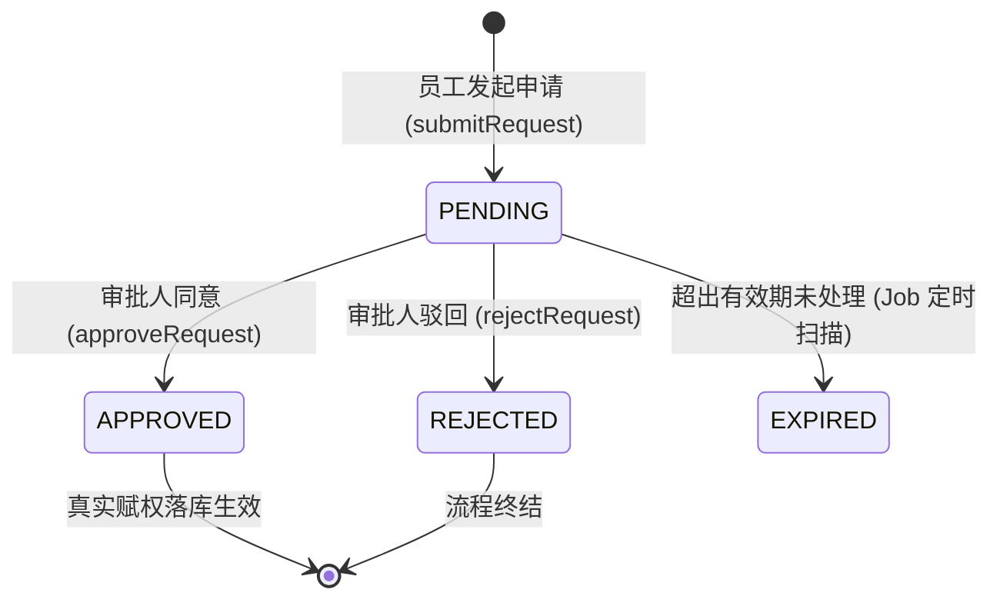

#### 动态职责分离（Dynamic SoD）防范自我审批

- 校验规则：> **动态职责分离约束**：`applicant_user_id == approver_user_id` ==> 阻断审批并抛出 `403 IAM_SOD_SELF_APPROVAL_DENIED`
- 申请人严禁审批自己的提权申请，保障企业权限合规边界。

---

### 5.3 审批批准后真实业务动作执行闭环

**铁律：审批通过必须实际执行底层业务赋权，严禁仅修改审批单状态。**

当审批人调用 `/api/v1/approvals/{id}/approve` 批准申请时，`PermissionApprovalUseCase` 必须通过出站端口原子触发底层赋权：

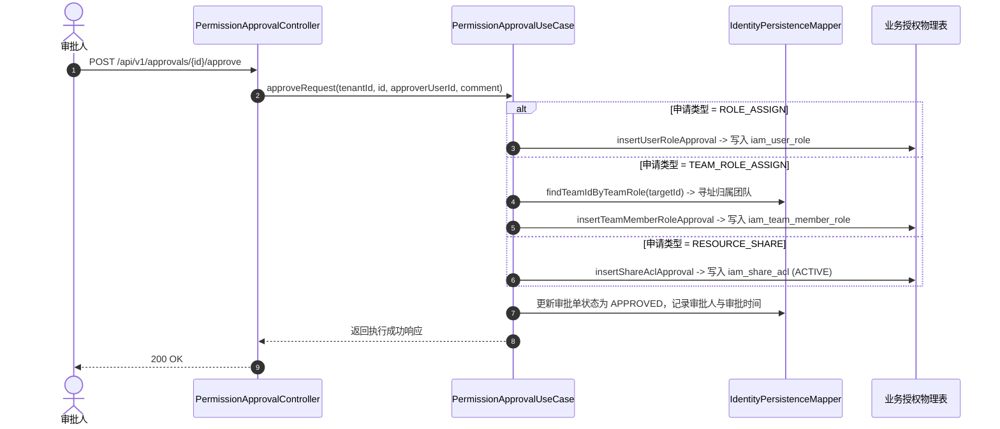

- **原子性与失败回滚**：审批状态变更与实际权限事实落库在同一个本地数据库事务中执行，若赋权失败，审批单状态无条件回滚，绝不产生“已批准却未赋权”的脏状态。

> [🔝 回到目录索引](#目录索引)

---

## 第六部分 多维统一授权与决策引擎领域 (Unified Authorization and Decision Engine)

### 6.1 应用-服务-资源-操作 (Application-Service-Resource-Operation) 模型

权限实体建立严谨的四层元数据分级关系：

- **Application（应用）**：顶层企业业务系统注册（如 ERP、CRM、文件中心）。
- **Service（微服务）**：承载具体业务能力的微服务单元。
- **Resource（资源类型）**：受权限保护的业务实体（如 `Order` 订单、`File` 文档）。
- **Operation（操作原子）**：资源上的具体动词（如 `read`、`create`、`approve`、`download`）。

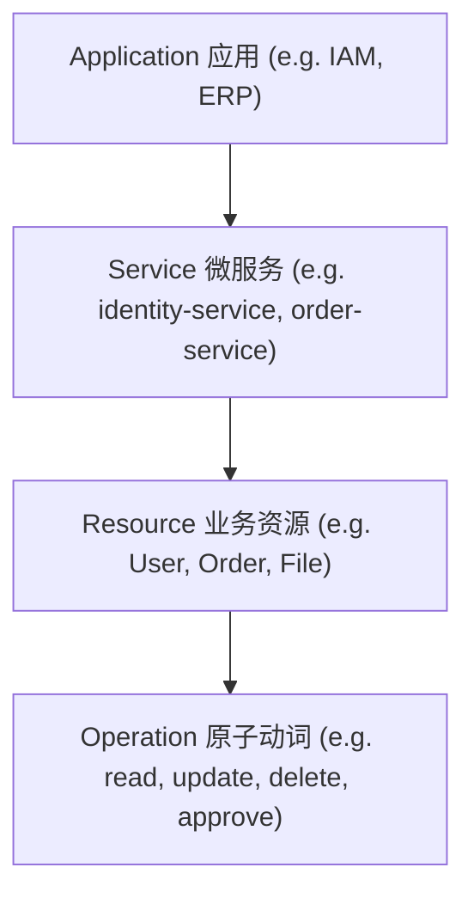

---

### 6.2 RBAC 与 TeamRole 与 ShareACL 多轨合并决策流水线与算法伪代码

#### 决策流水线 5 步走

1. **基础资源与操作有效性校验**：确认目标资源及操作在系统中处于已启用状态；
2. **共享 ACL 投影单调纪元围栏**：校验本地投影纪元，一旦落后触发 Fail-Closed；
3. **多轨正向授权事实收集**：收集主体命中的全局角色（RBAC）、所属团队角色（TeamRole）及直接分享（ShareACL）；若无任何匹配的正向授予，返回 `DENY`；
4. **ABAC Condition DSL 动态条件求值**：逐一评估绑定的条件策略，任一不满足即返回 `DENY`；
5. **义务组装（Obligations）**：计算行级数据范围（DataScope）与列级字段脱敏（FieldPolicy），随响应返回。

#### 授权判定算法伪代码

```java
public AuthorizationResult evaluate(AuthorizationRequest request, AuthorizationFacts facts) {
    // 1. 基础资源与操作有效性校验
    if (!facts.resourceOperationEnabled()) {
        return AuthorizationResult.deny("IAM_AUTHZ_RESOURCE_DISABLED");
    }

    // 2. 检查共享 ACL 投影单调纪元围栏 (Fail-Closed)
    if (!facts.shareProjectionFresh()) {
        return AuthorizationResult.deny("IAM_SHARE_PROJECTION_STALE");
    }

    // 3. 收集所有正向 Grants (RBAC 全局角色 + Team 团队角色 + Share 跨主体分享)
    List<ResolvedGrant> activeGrants = facts.grants().stream()
        .filter(g -> g.effect() == GrantEffect.ALLOW && g.isActiveAt(request.accessTime()))
        .toList();

    if (activeGrants.isEmpty() && facts.shareGrants().isEmpty()) {
        return AuthorizationResult.deny("IAM_AUTHZ_DENIED");
    }

    // 4. 评估 ABAC Condition DSL 动态条件
    for (AbacPolicy policy : facts.abacPolicies()) {
        boolean match = conditionDslEvaluator.evaluate(policy.expression(), request.context());
        if (!match) {
            return AuthorizationResult.deny("IAM_AUTHZ_CONDITION_DENIED");
        }
    }

    // 5. 组装 Obligations (行级数据范围 + 列级字段脱敏策略)
    Map<String, Object> obligations = new HashMap<>();
    obligations.put("dataScopes", compileDataScopes(facts.roleDataScopes()));
    obligations.put("fieldGrants", compileFieldPolicies(facts.roleFieldPolicies(), facts.maskStrategies()));

    return AuthorizationResult.allow(obligations);
}
```

---

### 6.3 统一授权决策流水线与 API 映射机制

网关或内部业务服务发起鉴权调用 `/internal/v1/authorization/check`：

- **请求入参**：
  ```json
  {
    "tenantId": "1",
    "userId": "10029384",
    "resourceKey": "order",
    "operationKey": "read",
    "context": {
      "ip": "10.0.1.20",
      "departmentId": "2001",
      "deviceTrust": "HIGH"
    }
  }
  ```
- **响应内容**：
  ```json
  {
    "decision": "ALLOW",
    "decisionId": "9182371982739182",
    "reasonCode": "IAM_AUTHZ_ALLOWED",
    "permissionVersion": 12,
    "obligations": {
      "dataScopes": [
        { "scopeType": "DEPT_AND_CHILDREN", "deptId": "2001" }
      ],
      "fieldGrants": {
        "customerName": { "readable": true, "maskStrategy": "CHINESE_NAME" },
        "costPrice": { "readable": false, "hidden": true }
      }
    }
  }
  ```

---

### 6.4 ABAC 策略与受限安全 Condition DSL 规约 (DEC-014)

#### 受限语法规格（DEC-014）

为防范动态条件表达式求值被利用进行远程代码执行（RCE）或消耗过多服务器资源，引擎实现了专用的**受限语法求值器（`ConditionDslEvaluator`）**：

- **最大表达式长度**：≤ 1024 字符。
- **最大 AST 语法树深度**：≤ 8 层。
- **最大 Token 词法数**：≤ 64 个。
- **支持的操作符**：`==`, `!=`, `>`, `>=`, `<`, `<=`, `in`, `contains`, `startsWith`, `endsWith`, `&&`, `||`, `!`, `matches`（受限安全正则）。
- **Fail-Closed 原则**：若表达式解析出错、环境上下文缺失属性或超出复杂度上限，求值器一律抛出异常并直接触发 `DENY`，绝不回退放行。

#### BNF 语法规格

```ebnf
Expression   ::= LogicalOr
LogicalOr    ::= LogicalAnd ( "||" LogicalAnd )*
LogicalAnd   ::= Equality ( "&&" Equality )*
Equality     ::= Relational ( ( "==" | "!=" ) Relational )*
Relational   ::= Primary ( ( ">" | ">=" | "<" | "<=" | "in" | "contains" | "startsWith" | "endsWith" | "matches" ) Primary )*
Primary      ::= Identifier | Literal | "(" Expression ")" | "!" Primary
```

---

### 6.5 决策解释器 (Explain Engine 与数据脱敏推理追溯)

针对合规审计与权限排错，提供 `/internal/v1/authorization/decisions/{decisionId}/explain` 端点：

- 清晰还原决策判定链（评估时刻、版本、命中的 Role/TeamRole/Share 依据、ABAC 评估逻辑）；
- **数据脱敏保护**：Explain 结果自动隐藏客户敏感数据、密码散列或商业机密谓词，保障推理透明度与数据隐私安全。

> [🔝 回到目录索引](#目录索引)

---

## 第七部分 行级数据范围与列级字段安全领域 (Data Scope and Field Policy)

### 7.1 7 类行级数据范围模型与 AST 谓词生成模板

| 范围类型 (`scope_type`) | 语义解释与生成 SQL 谓词模板                                                                                               |
| :------------------ | :------------------------------------------------------------------------------------------------------------- |
| `ALL`               | 租户内全量数据放行（无额外行级过滤）                                                                                             |
| `SELF`              | 仅本人创建/所属的数据：`WHERE creator_id = #{currentUserId}`                                                              |
| `DEPT`              | 仅本部门的数据：`WHERE dept_id = #{currentDeptId}`                                                                     |
| `DEPT_AND_CHILDREN` | 本部门及全部子孙部门：`WHERE dept_id IN (SELECT descendant_id FROM iam_org_closure WHERE ancestor_id = #{currentDeptId})` |
| `TEAM`              | 仅所属团队的数据：`WHERE team_id = #{currentTeamId}`                                                                    |
| `SPECIFIED_TEAM`    | 指定选中的团队清单：`WHERE team_id IN (#{teamId1}, #{teamId2}, ...)`                                                     |
| `CUSTOM_SQL`        | 预先在平台配置并审核通过的参数化安全 SQL 模板                                                                                      |

---

### 7.2 数据范围 SQL 谓词编译与 MyBatis 拦截器防注入

- **MyBatis 拦截器集成**：通过 `iam-data-permission-spring-boot-starter` 自动拦截业务 SQL。
- **AST 语法树注入**：利用 JSqlParser 在查询语句的 `WHERE` 条件中自动以 `AND (...)` 形式追加数据范围谓词。
- **全生命周期防注入**：拼接谓词内的变量一律使用参数化占位符，严禁字符串拼装。

---

### 7.3 列级字段读写隐藏策略 (READ WRITE HIDE)

- **READ**：允许在接口响应中读取（若配置脱敏规则则返回掩码后文本）。
- **WRITE**：允许客户端在 `POST`/`PUT` 请求中提交该字段；若未授权写，`FieldWritePlan` 直接丢弃或抛出 `403 IAM_FIELD_WRITE_DENIED`。
- **HIDE**：完全不可见，网关与序列化器直接将其从 JSON 输出中剔除或置 `null`。

---

### 7.4 字段动态脱敏引擎 (TypedMasker 7 类掩码算法)

脱敏引擎支持 7 类预置安全掩码策略：

1. **CHINESE\_NAME**：李\*、张\*丰。
2. **PHONE**：`138****1234`（前 3 后 4）。
3. **ID\_CARD**：`110101********1234`（前 6 后 4）。
4. **BANK\_CARD**：`622202******1234`（前 6 后 4）。
5. **EMAIL**：`z***n@example.com`。
6. **PASSWORD**：恒定输出 `"******"`。
7. **CUSTOM\_MASK**：自定义前后保留位数的通用掩码。

> **Fail-Closed 降级**：当脱敏规则缺失、配置损坏或源字符串长度不足以安全切分时，一律回退为全局全掩码 `"***"`，绝不泄露原始明文。

> [🔝 回到目录索引](#目录索引)

---

## 第八部分 细粒度资源跨主体共享领域 (Resource Sharing and ACL)

### 8.1 共享范围与继承机制 (Instance Folder Collection)

- **INSTANCE（单实例共享）**：精确指定某一个资源对象（如某份指定文件、某张指定订单）授权给特定人员或团队。
- **FOLDER\_INHERITED（文件夹级联继承）**：将目录容器授权给主体，该目录下所有新建或移动进入的子文件与子目录自动继承相同的访问策略。
- **COLLECTION（资源集合打包共享）**：将多个离散资源归组为一个业务包进行批量分享。

#### 目标主体展开

共享支持向 `USER`、`TEAM`、`ROLE`、`TEAM_ROLE` 四类主体授予；授权引擎在决策时自动扁平化展开。

---

### 8.2 共享权限边界校验与传递性重分享 (Reshare) 防越权

- **权利下限原则**：授予者的操作集合与字段权限集合构成共享的硬上限。授予者严禁把自身不具备的操作权限授予第三方（`403 IAM_SHARE_OPERATION_ESCALATION`）。
- **转分享控制（Reshare）**：只有原分享明确赋予了 `allow_reshare = true` 属性时，被授权主体才可二次向下转分享，且转分享的权限范围必须为原权限的严格子集。

---

### 8.3 跨服务投影纪元单调围栏 (Projection Epoch Fence)

跨服务共享 ACL 采用异步事件投影到授权服务本地缓存。为防止由于网络延迟导致的“早熟消费”或“已撤销权限死灰复燃”，采用单调纪元围栏机制：

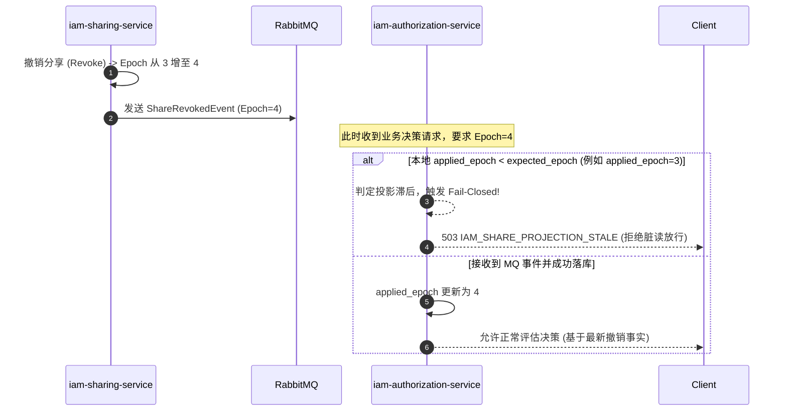

---

### 8.4 Seata 分布式事务与跨库撤销最终一致性

- 在跨租户资源归属解绑等关键强一致性场景，通过集成 Seata AT/TCC 模式协同多个微服务的分布式事务；
- 异步补偿兜底：结合事务 Outbox 与定时 Reconciliation Job，实现分布式最终一致性闭环。

> [🔝 回到目录索引](#目录索引)

---

## 第九部分 企业文件传输与数据安全防泄漏领域 (Enterprise File and DLP)

### 9.1 前端 Web Worker 哈希秒传与 S3/MinIO 分片直传及 CAS 合并

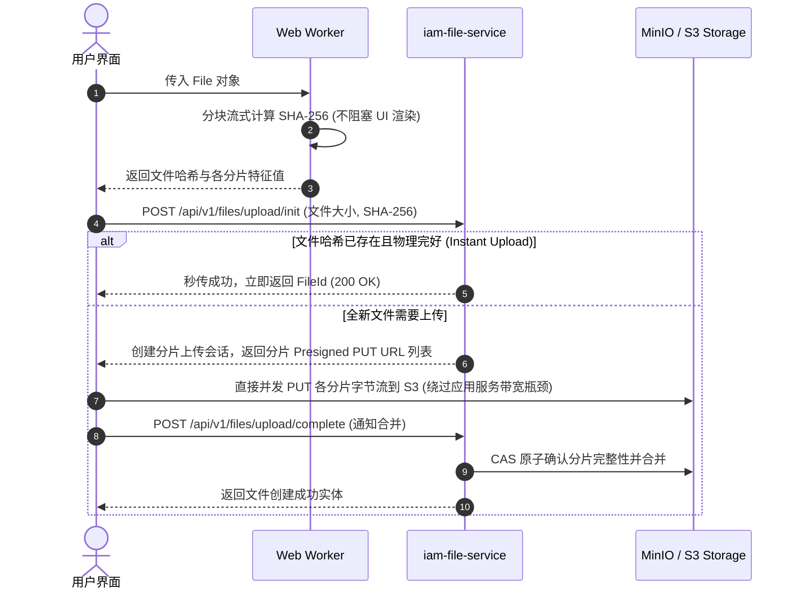

---

### 9.2 动态防篡改可见与隐式数字指纹签名水印

文件预览与下载由 `iam-file-service` 提供动态防泄漏保护：

- **显式可见水印**：在 PDF/Office 预览界面渲染半透明平铺水印（包含当前访问用户账号、工号、真实姓名、当前时间戳及租户 Code）。
- **隐式数字指纹**：通过盲水印与防篡改微签名技术嵌入到文档底层，即便遭遇手机拍照或截图，通过溯源工具依然可提取出泄密者身份与请求 TraceId。

---

### 9.3 内容安全检查状态机 (DLP ZIP Bomb 病毒扫描 SPI)

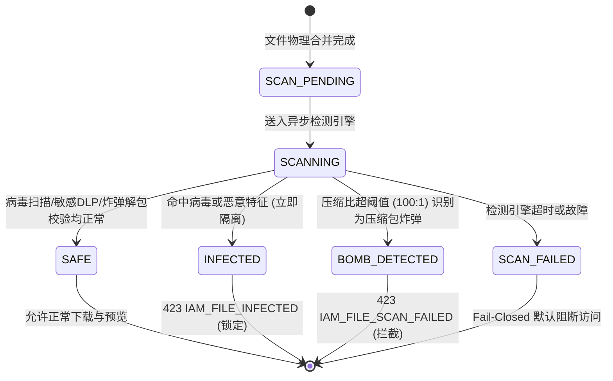

---

### 9.4 存储生命周期 Glacier 冷归档与 S204 容灾恢复演练

- **存储分层**：支持标准存储（Standard）-> 低频访问（IA）-> 归档存储（Glacier）自动生命周期流转。
- **物理安全擦除（D-18）**：删除文件经软删除静默期后，通过 MinIO 适配器触发底层扇区覆写与物理 Object 彻底擦除。
- **S204 容灾演练**：提供跨区域多活、多 Bucket 异步双写与冷备灾难恢复演练机制。

> [🔝 回到目录索引](#目录索引)

---

## 第十部分 物理数据库设计与 Flyway Schema 规格 (Physical Database Schema)

### 10.1 数据库总体策略与基线规范

- **数据库引擎**：MySQL 8.4 LTS+，InnoDB，`utf8mb4_0900_ai_ci`。
- **时间标准**：全库统一使用 UTC 时间戳，精度统一采用 `DATETIME(3)`。
- **主键策略**：业务表统一采用 `BIGINT` 64 位整型（Snowflake / MyBatis-Plus ASSIGN\_ID），严禁跨服务依赖自增序列。
- **逻辑删除索引规范**：为防止软删除记录与新建记录在业务唯一索引上冲突，统一采用版本号或状态复合索引，严禁设计无法重用的唯一键。

---

### 10.2 iam_auth 数据库核心表 DDL 与索引

#### `iam_password_credential`（密码凭据表）

```sql
CREATE TABLE `iam_password_credential` (
    `id` BIGINT NOT NULL COMMENT '凭据ID',
    `tenant_id` BIGINT NOT NULL COMMENT '租户ID',
    `user_id` BIGINT NOT NULL COMMENT '关联用户ID',
    `identity_type` VARCHAR(32) NOT NULL COMMENT '凭据类型: USERNAME, EMAIL, PHONE',
    `identity_value` VARCHAR(128) NOT NULL COMMENT '登录凭据值',
    `password_hash` VARCHAR(256) NOT NULL COMMENT 'Argon2id 散列密码串',
    `status` VARCHAR(32) NOT NULL DEFAULT 'ACTIVE' COMMENT '凭据状态',
    `created_at` DATETIME(3) NOT NULL DEFAULT CURRENT_TIMESTAMP(3),
    `updated_at` DATETIME(3) NOT NULL DEFAULT CURRENT_TIMESTAMP(3) ON UPDATE CURRENT_TIMESTAMP(3),
    PRIMARY KEY (`id`),
    UNIQUE KEY `uk_tenant_identity` (`tenant_id`, `identity_type`, `identity_value`),
    KEY `idx_tenant_user` (`tenant_id`, `user_id`)
) ENGINE=InnoDB DEFAULT CHARSET=utf8mb4 COMMENT='认证密码凭据表';
```

#### `iam_login_session`（登录会话表）

```sql
CREATE TABLE `iam_login_session` (
    `id` BIGINT NOT NULL,
    `tenant_id` BIGINT NOT NULL,
    `user_id` BIGINT NOT NULL,
    `session_id` VARCHAR(64) NOT NULL,
    `session_version` INT NOT NULL DEFAULT 1,
    `status` VARCHAR(32) NOT NULL DEFAULT 'ACTIVE',
    `ip_address` VARCHAR(45) NULL,
    `user_agent` VARCHAR(256) NULL,
    `expires_at` DATETIME(3) NOT NULL,
    `created_at` DATETIME(3) NOT NULL DEFAULT CURRENT_TIMESTAMP(3),
    `updated_at` DATETIME(3) NOT NULL DEFAULT CURRENT_TIMESTAMP(3) ON UPDATE CURRENT_TIMESTAMP(3),
    PRIMARY KEY (`id`),
    UNIQUE KEY `uk_tenant_session` (`tenant_id`, `session_id`),
    KEY `idx_tenant_user_status` (`tenant_id`, `user_id`, `status`)
) ENGINE=InnoDB DEFAULT CHARSET=utf8mb4 COMMENT='登录会话主表';
```

#### `iam_refresh_token`（轮换刷新令牌表）

```sql
CREATE TABLE `iam_refresh_token` (
    `id` BIGINT NOT NULL,
    `tenant_id` BIGINT NOT NULL,
    `user_id` BIGINT NOT NULL,
    `session_id` VARCHAR(64) NOT NULL,
    `token_hash` VARCHAR(128) NOT NULL COMMENT 'Refresh Token SHA-256 摘要',
    `family_id` VARCHAR(64) NOT NULL COMMENT '令牌轮换家族ID',
    `consumed` TINYINT(1) NOT NULL DEFAULT 0 COMMENT '是否已消费',
    `revoked` TINYINT(1) NOT NULL DEFAULT 0 COMMENT '是否已吊销',
    `expires_at` DATETIME(3) NOT NULL,
    `created_at` DATETIME(3) NOT NULL DEFAULT CURRENT_TIMESTAMP(3),
    PRIMARY KEY (`id`),
    UNIQUE KEY `uk_token_hash` (`token_hash`),
    KEY `idx_session` (`tenant_id`, `session_id`),
    KEY `idx_family` (`family_id`)
) ENGINE=InnoDB DEFAULT CHARSET=utf8mb4 COMMENT='刷新令牌轮换表';
```

#### `iam_webauthn_credential`（FIDO2 Passkey 凭据表）

```sql
CREATE TABLE `iam_webauthn_credential` (
    `id` BIGINT NOT NULL,
    `tenant_id` BIGINT NOT NULL,
    `user_id` BIGINT NOT NULL,
    `credential_id` VARCHAR(256) NOT NULL,
    `public_key_cose` TEXT NOT NULL,
    `sign_count` BIGINT NOT NULL DEFAULT 0 COMMENT '防克隆计数器',
    `aaguid` VARCHAR(64) NULL,
    `status` VARCHAR(32) NOT NULL DEFAULT 'ACTIVE',
    `created_at` DATETIME(3) NOT NULL DEFAULT CURRENT_TIMESTAMP(3),
    PRIMARY KEY (`id`),
    UNIQUE KEY `uk_cred_id` (`credential_id`),
    KEY `idx_user` (`tenant_id`, `user_id`)
) ENGINE=InnoDB DEFAULT CHARSET=utf8mb4 COMMENT='WebAuthn 硬件凭据表';
```

#### `sys_outbox_event`（事务性本地 Outbox 表）

```sql
CREATE TABLE `sys_outbox_event` (
    `id` BIGINT NOT NULL,
    `event_id` VARCHAR(64) NOT NULL,
    `aggregate_type` VARCHAR(64) NOT NULL,
    `aggregate_id` VARCHAR(64) NOT NULL,
    `event_type` VARCHAR(64) NOT NULL,
    `payload` TEXT NOT NULL,
    `status` VARCHAR(32) NOT NULL DEFAULT 'PENDING' COMMENT 'PENDING, PUBLISHED, FAILED',
    `retry_count` INT NOT NULL DEFAULT 0,
    `created_at` DATETIME(3) NOT NULL DEFAULT CURRENT_TIMESTAMP(3),
    `updated_at` DATETIME(3) NOT NULL DEFAULT CURRENT_TIMESTAMP(3) ON UPDATE CURRENT_TIMESTAMP(3),
    PRIMARY KEY (`id`),
    KEY `idx_status_created` (`status`, `created_at`)
) ENGINE=InnoDB DEFAULT CHARSET=utf8mb4 COMMENT='事务性 Outbox 事件表';
```

---

### 10.3 iam_identity 数据库核心表 DDL 与索引

#### `iam_tenant`（租户表）

```sql
CREATE TABLE `iam_tenant` (
    `id` BIGINT NOT NULL,
    `tenant_code` VARCHAR(64) NOT NULL,
    `tenant_name` VARCHAR(128) NOT NULL,
    `status` VARCHAR(32) NOT NULL DEFAULT 'INITIALIZING',
    `version` INT NOT NULL DEFAULT 0,
    `created_at` DATETIME(3) NOT NULL DEFAULT CURRENT_TIMESTAMP(3),
    `updated_at` DATETIME(3) NOT NULL DEFAULT CURRENT_TIMESTAMP(3) ON UPDATE CURRENT_TIMESTAMP(3),
    PRIMARY KEY (`id`),
    UNIQUE KEY `uk_tenant_code` (`tenant_code`)
) ENGINE=InnoDB DEFAULT CHARSET=utf8mb4 COMMENT='租户表';
```

#### `iam_user`（用户主数据表）

```sql
CREATE TABLE `iam_user` (
    `id` BIGINT NOT NULL COMMENT '用户ID',
    `tenant_id` BIGINT NOT NULL COMMENT '租户ID',
    `username` VARCHAR(64) NOT NULL COMMENT '系统用户名',
    `real_name` VARCHAR(64) NULL COMMENT '真实姓名',
    `email` VARCHAR(128) NULL,
    `phone` VARCHAR(32) NULL,
    `department_id` BIGINT NULL COMMENT '归属部门ID',
    `position_id` BIGINT NULL COMMENT '分配岗位ID',
    `status` VARCHAR(32) NOT NULL DEFAULT 'ACTIVE' COMMENT 'ACTIVE, DISABLED, LOCKED',
    `version` INT NOT NULL DEFAULT 0 COMMENT '乐观锁版本',
    `created_at` DATETIME(3) NOT NULL DEFAULT CURRENT_TIMESTAMP(3),
    `updated_at` DATETIME(3) NOT NULL DEFAULT CURRENT_TIMESTAMP(3) ON UPDATE CURRENT_TIMESTAMP(3),
    PRIMARY KEY (`id`),
    UNIQUE KEY `uk_tenant_username` (`tenant_id`, `username`),
    KEY `idx_tenant_dept` (`tenant_id`, `department_id`),
    KEY `idx_tenant_position` (`tenant_id`, `position_id`)
) ENGINE=InnoDB DEFAULT CHARSET=utf8mb4 COMMENT='租户用户表';
```

#### `iam_role` 与 `iam_user_role`（全局角色与用户角色映射表）

```sql
CREATE TABLE `iam_role` (
    `id` BIGINT NOT NULL,
    `tenant_id` BIGINT NOT NULL,
    `role_code` VARCHAR(64) NOT NULL,
    `role_name` VARCHAR(128) NOT NULL,
    `description` VARCHAR(256) NULL,
    `status` VARCHAR(32) NOT NULL DEFAULT 'ACTIVE',
    `created_at` DATETIME(3) NOT NULL DEFAULT CURRENT_TIMESTAMP(3),
    `updated_at` DATETIME(3) NOT NULL DEFAULT CURRENT_TIMESTAMP(3) ON UPDATE CURRENT_TIMESTAMP(3),
    PRIMARY KEY (`id`),
    UNIQUE KEY `uk_tenant_role_code` (`tenant_id`, `role_code`)
) ENGINE=InnoDB DEFAULT CHARSET=utf8mb4 COMMENT='系统角色表';

CREATE TABLE `iam_user_role` (
    `id` BIGINT NOT NULL,
    `tenant_id` BIGINT NOT NULL,
    `user_id` BIGINT NOT NULL,
    `role_id` BIGINT NOT NULL,
    `created_at` DATETIME(3) NOT NULL DEFAULT CURRENT_TIMESTAMP(3),
    PRIMARY KEY (`id`),
    UNIQUE KEY `uk_tenant_user_role` (`tenant_id`, `user_id`, `role_id`),
    KEY `idx_tenant_role_user` (`tenant_id`, `role_id`)
) ENGINE=InnoDB DEFAULT CHARSET=utf8mb4 COMMENT='用户角色关系表';
```

#### `iam_menu`（动态菜单主数据表）

```sql
CREATE TABLE `iam_menu` (
    `id` BIGINT NOT NULL,
    `tenant_id` BIGINT NOT NULL,
    `parent_id` BIGINT NULL,
    `code` VARCHAR(64) NOT NULL,
    `title` VARCHAR(128) NOT NULL,
    `path` VARCHAR(256) NULL,
    `component` VARCHAR(256) NULL,
    `icon` VARCHAR(64) NULL,
    `permission` VARCHAR(128) NULL,
    `menu_type` VARCHAR(32) NOT NULL COMMENT 'DIRECTORY, MENU, BUTTON',
    `sort_order` INT NOT NULL DEFAULT 0,
    `status` VARCHAR(32) NOT NULL DEFAULT 'ACTIVE',
    `publish_status` VARCHAR(32) NOT NULL DEFAULT 'DRAFT' COMMENT 'DRAFT, PUBLISHED',
    `created_at` DATETIME(3) NOT NULL DEFAULT CURRENT_TIMESTAMP(3),
    `updated_at` DATETIME(3) NOT NULL DEFAULT CURRENT_TIMESTAMP(3) ON UPDATE CURRENT_TIMESTAMP(3),
    PRIMARY KEY (`id`),
    UNIQUE KEY `uk_tenant_menu_code` (`tenant_id`, `code`),
    KEY `idx_tenant_parent` (`tenant_id`, `parent_id`)
) ENGINE=InnoDB DEFAULT CHARSET=utf8mb4 COMMENT='动态菜单与功能权限表';
```

#### `iam_permission_approval_request`（权限申请与审批表）

```sql
CREATE TABLE `iam_permission_approval_request` (
    `id` BIGINT NOT NULL,
    `tenant_id` BIGINT NOT NULL,
    `applicant_user_id` BIGINT NOT NULL,
    `request_type` VARCHAR(32) NOT NULL COMMENT 'ROLE_ASSIGN, TEAM_ROLE_ASSIGN, RESOURCE_SHARE',
    `target_id` BIGINT NOT NULL COMMENT '目标实体ID',
    `target_name` VARCHAR(128) NOT NULL,
    `justification` VARCHAR(256) NOT NULL COMMENT '申请原因',
    `duration_hours` INT NOT NULL DEFAULT 168 COMMENT '时效(小时)',
    `status` VARCHAR(32) NOT NULL DEFAULT 'PENDING' COMMENT 'PENDING, APPROVED, REJECTED, EXPIRED',
    `approver_user_id` BIGINT NULL,
    `decision_comment` VARCHAR(256) NULL,
    `decided_at` DATETIME(3) NULL,
    `version` INT NOT NULL DEFAULT 0,
    `created_at` DATETIME(3) NOT NULL DEFAULT CURRENT_TIMESTAMP(3),
    PRIMARY KEY (`id`),
    KEY `idx_tenant_status` (`tenant_id`, `status`),
    KEY `idx_applicant` (`tenant_id`, `applicant_user_id`)
) ENGINE=InnoDB DEFAULT CHARSET=utf8mb4 COMMENT='权限申请审批表';
```

#### `iam_dict_type` 与 `iam_dict_data`（通用数据字典类型与键值项表）

```sql
CREATE TABLE `iam_dict_type` (
    `id` BIGINT UNSIGNED NOT NULL COMMENT '字典类型ID',
    `tenant_id` BIGINT UNSIGNED NOT NULL COMMENT '租户ID',
    `dict_type` VARCHAR(64) NOT NULL COMMENT '字典类型唯一编码',
    `dict_name` VARCHAR(128) NOT NULL COMMENT '字典类型名称',
    `status` VARCHAR(32) NOT NULL DEFAULT 'ACTIVE' COMMENT 'ACTIVE, DISABLED',
    `description` VARCHAR(255) NULL COMMENT '描述说明',
    `delete_marker` BIGINT UNSIGNED NOT NULL DEFAULT 0 COMMENT '逻辑删除标记',
    `version` BIGINT UNSIGNED NOT NULL DEFAULT 0 COMMENT '乐观锁版本',
    `created_at` DATETIME(3) NOT NULL DEFAULT CURRENT_TIMESTAMP(3),
    `updated_at` DATETIME(3) NOT NULL DEFAULT CURRENT_TIMESTAMP(3) ON UPDATE CURRENT_TIMESTAMP(3),
    PRIMARY KEY (`id`),
    UNIQUE KEY `uk_dict_type` (`tenant_id`, `dict_type`, `delete_marker`),
    KEY `idx_dict_type_tenant` (`tenant_id`, `status`)
) ENGINE=InnoDB DEFAULT CHARSET=utf8mb4 COMMENT='通用数据字典类型主表';

CREATE TABLE `iam_dict_data` (
    `id` BIGINT UNSIGNED NOT NULL COMMENT '字典数据ID',
    `tenant_id` BIGINT UNSIGNED NOT NULL COMMENT '租户ID',
    `dict_type` VARCHAR(64) NOT NULL COMMENT '归属字典类型编码',
    `dict_label` VARCHAR(128) NOT NULL COMMENT '字典展示标签',
    `dict_value` VARCHAR(128) NOT NULL COMMENT '字典键值',
    `sort_order` INT NOT NULL DEFAULT 0 COMMENT '排序权重',
    `status` VARCHAR(32) NOT NULL DEFAULT 'ACTIVE' COMMENT 'ACTIVE, DISABLED',
    `css_tag` VARCHAR(64) NULL COMMENT '前端 Tag 渲染样式属性',
    `is_default` TINYINT UNSIGNED NOT NULL DEFAULT 0 COMMENT '是否为默认选项',
    `description` VARCHAR(255) NULL COMMENT '描述说明',
    `delete_marker` BIGINT UNSIGNED NOT NULL DEFAULT 0 COMMENT '逻辑删除标记',
    `version` BIGINT UNSIGNED NOT NULL DEFAULT 0 COMMENT '乐观锁版本',
    `created_at` DATETIME(3) NOT NULL DEFAULT CURRENT_TIMESTAMP(3),
    `updated_at` DATETIME(3) NOT NULL DEFAULT CURRENT_TIMESTAMP(3) ON UPDATE CURRENT_TIMESTAMP(3),
    PRIMARY KEY (`id`),
    UNIQUE KEY `uk_dict_data_value` (`tenant_id`, `dict_type`, `dict_value`, `delete_marker`),
    KEY `idx_dict_data_type` (`tenant_id`, `dict_type`, `sort_order`)
) ENGINE=InnoDB DEFAULT CHARSET=utf8mb4 COMMENT='通用数据字典键值数据表';
```

---

### 10.4 iam_organization 数据库核心表 DDL 与索引

#### iam_organization`（部门/组织表）与 `iam_position`（岗位表）

```sql
CREATE TABLE iam_organization` (
    `id` BIGINT NOT NULL,
    `tenant_id` BIGINT NOT NULL,
    `parent_id` BIGINT NULL,
    `org_code` VARCHAR(64) NOT NULL,
    `org_name` VARCHAR(128) NOT NULL,
    `sort_order` INT NOT NULL DEFAULT 0,
    `status` VARCHAR(32) NOT NULL DEFAULT 'ACTIVE',
    `version` INT NOT NULL DEFAULT 0,
    `created_at` DATETIME(3) NOT NULL DEFAULT CURRENT_TIMESTAMP(3),
    `updated_at` DATETIME(3) NOT NULL DEFAULT CURRENT_TIMESTAMP(3) ON UPDATE CURRENT_TIMESTAMP(3),
    PRIMARY KEY (`id`),
    UNIQUE KEY `uk_tenant_org_code` (`tenant_id`, `org_code`),
    KEY `idx_tenant_parent` (`tenant_id`, `parent_id`)
) ENGINE=InnoDB DEFAULT CHARSET=utf8mb4 COMMENT='组织机构与部门表';

CREATE TABLE `iam_position` (
    `id` BIGINT NOT NULL,
    `tenant_id` BIGINT NOT NULL,
    `code` VARCHAR(64) NOT NULL,
    `name` VARCHAR(128) NOT NULL,
    `sort_order` INT NOT NULL DEFAULT 0,
    `status` VARCHAR(32) NOT NULL DEFAULT 'ACTIVE',
    `created_at` DATETIME(3) NOT NULL DEFAULT CURRENT_TIMESTAMP(3),
    `updated_at` DATETIME(3) NOT NULL DEFAULT CURRENT_TIMESTAMP(3) ON UPDATE CURRENT_TIMESTAMP(3),
    PRIMARY KEY (`id`),
    UNIQUE KEY `uk_tenant_pos_code` (`tenant_id`, `code`),
    KEY `idx_tenant_status` (`tenant_id`, `status`)
) ENGINE=InnoDB DEFAULT CHARSET=utf8mb4 COMMENT='岗位主数据表';
```

#### `iam_team`、`iam_team_role` 与 `iam_team_member`（团队协作表组）

```sql
CREATE TABLE `iam_team` (
    `id` BIGINT NOT NULL,
    `tenant_id` BIGINT NOT NULL,
    `team_code` VARCHAR(64) NOT NULL,
    `team_name` VARCHAR(128) NOT NULL,
    `leader_id` BIGINT NULL,
    `status` VARCHAR(32) NOT NULL DEFAULT 'ACTIVE',
    `created_at` DATETIME(3) NOT NULL DEFAULT CURRENT_TIMESTAMP(3),
    PRIMARY KEY (`id`),
    UNIQUE KEY `uk_tenant_team_code` (`tenant_id`, `team_code`)
) ENGINE=InnoDB DEFAULT CHARSET=utf8mb4 COMMENT='团队主表';

CREATE TABLE `iam_team_role` (
    `id` BIGINT NOT NULL,
    `tenant_id` BIGINT NOT NULL,
    `team_id` BIGINT NOT NULL,
    `role_code` VARCHAR(64) NOT NULL,
    `role_name` VARCHAR(128) NOT NULL,
    `created_at` DATETIME(3) NOT NULL DEFAULT CURRENT_TIMESTAMP(3),
    PRIMARY KEY (`id`),
    UNIQUE KEY `uk_team_role_code` (`team_id`, `role_code`)
) ENGINE=InnoDB DEFAULT CHARSET=utf8mb4 COMMENT='团队角色定义表';

CREATE TABLE `iam_team_member` (
    `id` BIGINT NOT NULL,
    `tenant_id` BIGINT NOT NULL,
    `team_id` BIGINT NOT NULL,
    `user_id` BIGINT NOT NULL,
    `created_at` DATETIME(3) NOT NULL DEFAULT CURRENT_TIMESTAMP(3),
    PRIMARY KEY (`id`),
    UNIQUE KEY `uk_team_user` (`team_id`, `user_id`)
) ENGINE=InnoDB DEFAULT CHARSET=utf8mb4 COMMENT='团队成员表';

CREATE TABLE `iam_team_member_role` (
    `id` BIGINT NOT NULL,
    `tenant_id` BIGINT NOT NULL,
    `team_member_id` BIGINT NOT NULL,
    `team_role_id` BIGINT NOT NULL,
    `created_at` DATETIME(3) NOT NULL DEFAULT CURRENT_TIMESTAMP(3),
    PRIMARY KEY (`id`),
    UNIQUE KEY `uk_member_role` (`team_member_id`, `team_role_id`)
) ENGINE=InnoDB DEFAULT CHARSET=utf8mb4 COMMENT='团队成员角色关系表';
```

---

### 10.5 iam_authorization 数据库核心表 DDL 与索引

#### 四级权限元数据表（`iam_application`, `iam_service`, `iam_resource`, `iam_operation`）

```sql
CREATE TABLE `iam_application` (
    `id` BIGINT NOT NULL,
    `app_code` VARCHAR(64) NOT NULL,
    `app_name` VARCHAR(128) NOT NULL,
    PRIMARY KEY (`id`),
    UNIQUE KEY `uk_app_code` (`app_code`)
) ENGINE=InnoDB DEFAULT CHARSET=utf8mb4 COMMENT='应用元数据表';

CREATE TABLE `iam_service` (
    `id` BIGINT NOT NULL,
    `app_id` BIGINT NOT NULL,
    `service_code` VARCHAR(64) NOT NULL,
    `service_name` VARCHAR(128) NOT NULL,
    PRIMARY KEY (`id`),
    UNIQUE KEY `uk_service_code` (`app_id`, `service_code`)
) ENGINE=InnoDB DEFAULT CHARSET=utf8mb4 COMMENT='微服务元数据表';

CREATE TABLE `iam_resource` (
    `id` BIGINT NOT NULL,
    `service_id` BIGINT NOT NULL,
    `resource_key` VARCHAR(64) NOT NULL,
    `resource_name` VARCHAR(128) NOT NULL,
    PRIMARY KEY (`id`),
    UNIQUE KEY `uk_resource_key` (`service_id`, `resource_key`)
) ENGINE=InnoDB DEFAULT CHARSET=utf8mb4 COMMENT='业务资源表';

CREATE TABLE `iam_operation` (
    `id` BIGINT NOT NULL,
    `resource_id` BIGINT NOT NULL,
    `operation_key` VARCHAR(64) NOT NULL,
    `operation_name` VARCHAR(128) NOT NULL,
    PRIMARY KEY (`id`),
    UNIQUE KEY `uk_op_key` (`resource_id`, `operation_key`)
) ENGINE=InnoDB DEFAULT CHARSET=utf8mb4 COMMENT='资源操作原子表';
```

#### 授权策略表（`iam_role_permission`, `iam_data_scope`, `iam_field_policy`, `iam_abac_policy`）

```sql
CREATE TABLE `iam_role_permission` (
    `id` BIGINT NOT NULL,
    `tenant_id` BIGINT NOT NULL,
    `role_id` BIGINT NOT NULL,
    `resource_id` BIGINT NOT NULL,
    `operation_id` BIGINT NOT NULL,
    `effect` VARCHAR(16) NOT NULL DEFAULT 'ALLOW',
    PRIMARY KEY (`id`),
    UNIQUE KEY `uk_role_res_op` (`role_id`, `resource_id`, `operation_id`),
    KEY `idx_tenant_role` (`tenant_id`, `role_id`)
) ENGINE=InnoDB DEFAULT CHARSET=utf8mb4 COMMENT='角色权限操作关系表';

CREATE TABLE `iam_data_scope` (
    `id` BIGINT NOT NULL,
    `tenant_id` BIGINT NOT NULL,
    `role_permission_id` BIGINT NOT NULL,
    `scope_type` VARCHAR(32) NOT NULL COMMENT 'ALL, SELF, DEPT, DEPT_AND_CHILDREN, TEAM, SPECIFIED_TEAM, CUSTOM_SQL',
    `scope_expression` TEXT NULL,
    PRIMARY KEY (`id`),
    KEY `idx_role_perm` (`role_permission_id`)
) ENGINE=InnoDB DEFAULT CHARSET=utf8mb4 COMMENT='行级数据范围策略表';

CREATE TABLE `iam_field_policy` (
    `id` BIGINT NOT NULL,
    `tenant_id` BIGINT NOT NULL,
    `role_permission_id` BIGINT NOT NULL,
    `field_id` BIGINT NOT NULL,
    `readable` TINYINT(1) NOT NULL DEFAULT 1,
    `writable` TINYINT(1) NOT NULL DEFAULT 0,
    `hidden` TINYINT(1) NOT NULL DEFAULT 0,
    `mask_strategy_id` BIGINT NULL,
    PRIMARY KEY (`id`),
    KEY `idx_role_perm_field` (`role_permission_id`, `field_id`)
) ENGINE=InnoDB DEFAULT CHARSET=utf8mb4 COMMENT='字段安全脱敏策略表';

CREATE TABLE `iam_abac_policy` (
    `id` BIGINT NOT NULL,
    `tenant_id` BIGINT NOT NULL,
    `role_permission_id` BIGINT NOT NULL,
    `expression` VARCHAR(1024) NOT NULL COMMENT '受限语法 Condition DSL',
    `created_at` DATETIME(3) NOT NULL DEFAULT CURRENT_TIMESTAMP(3),
    PRIMARY KEY (`id`),
    KEY `idx_role_perm` (`role_permission_id`)
) ENGINE=InnoDB DEFAULT CHARSET=utf8mb4 COMMENT='ABAC 条件策略表';

CREATE TABLE `iam_share_acl_projection` (
    `id` BIGINT NOT NULL,
    `tenant_id` BIGINT NOT NULL,
    `resource_id` BIGINT NOT NULL,
    `resource_instance_key` VARCHAR(128) NOT NULL,
    `target_type` VARCHAR(32) NOT NULL,
    `target_id` BIGINT NOT NULL,
    `operation_id` BIGINT NOT NULL,
    `epoch` BIGINT NOT NULL DEFAULT 1,
    `status` VARCHAR(32) NOT NULL DEFAULT 'ACTIVE',
    `expire_time` DATETIME(3) NOT NULL,
    PRIMARY KEY (`id`),
    KEY `idx_tenant_target` (`tenant_id`, `target_type`, `target_id`),
    KEY `idx_res_instance` (`tenant_id`, `resource_id`, `resource_instance_key`)
) ENGINE=InnoDB DEFAULT CHARSET=utf8mb4 COMMENT='共享访问控制本地物化投影表';
```

---

### 10.6 iam_sharing 数据库核心表 DDL 与索引

#### `iam_resource_share`（资源跨主体共享控制表）

```sql
CREATE TABLE `iam_resource_share` (
    `id` BIGINT NOT NULL,
    `tenant_id` BIGINT NOT NULL,
    `resource_id` BIGINT NOT NULL,
    `resource_instance_key` VARCHAR(128) NOT NULL,
    `grantor_user_id` BIGINT NOT NULL,
    `target_type` VARCHAR(32) NOT NULL COMMENT 'USER, TEAM, ROLE, TEAM_ROLE',
    `target_id` BIGINT NOT NULL,
    `operation_id` BIGINT NOT NULL,
    `allow_reshare` TINYINT(1) NOT NULL DEFAULT 0,
    `scope_type` VARCHAR(32) NOT NULL DEFAULT 'INSTANCE',
    `epoch` BIGINT NOT NULL DEFAULT 1,
    `status` VARCHAR(32) NOT NULL DEFAULT 'ACTIVE',
    `start_time` DATETIME(3) NOT NULL,
    `expire_time` DATETIME(3) NOT NULL,
    `created_at` DATETIME(3) NOT NULL DEFAULT CURRENT_TIMESTAMP(3),
    PRIMARY KEY (`id`),
    KEY `idx_tenant_target` (`tenant_id`, `target_type`, `target_id`),
    KEY `idx_res_instance` (`tenant_id`, `resource_id`, `resource_instance_key`)
) ENGINE=InnoDB DEFAULT CHARSET=utf8mb4 COMMENT='资源共享访问控制主表';
```

---

### 10.7 iam_file 数据库核心表 DDL 与索引

#### iam_file_object` 与 iam_file`（物理对象与逻辑文件表）

```sql
CREATE TABLE iam_file_object` (
    `id` BIGINT NOT NULL,
    `tenant_id` BIGINT NOT NULL,
    `file_sha256` VARCHAR(64) NOT NULL,
    `file_size` BIGINT NOT NULL,
    `storage_bucket` VARCHAR(64) NOT NULL,
    `storage_object_key` VARCHAR(256) NOT NULL,
    `storage_tier` VARCHAR(32) NOT NULL DEFAULT 'STANDARD',
    `ref_count` INT NOT NULL DEFAULT 1,
    `created_at` DATETIME(3) NOT NULL DEFAULT CURRENT_TIMESTAMP(3),
    PRIMARY KEY (`id`),
    UNIQUE KEY `uk_tenant_sha256` (`tenant_id`, `file_sha256`)
) ENGINE=InnoDB DEFAULT CHARSET=utf8mb4 COMMENT='文件物理对象存储表';

CREATE TABLE iam_file` (
    `id` BIGINT NOT NULL,
    `tenant_id` BIGINT NOT NULL,
    `physical_object_id` BIGINT NOT NULL,
    `file_name` VARCHAR(256) NOT NULL,
    `file_size` BIGINT NOT NULL,
    `mime_type` VARCHAR(128) NOT NULL,
    `scan_status` VARCHAR(32) NOT NULL DEFAULT 'SCAN_PENDING',
    `status` VARCHAR(32) NOT NULL DEFAULT 'ACTIVE',
    `creator_id` BIGINT NOT NULL,
    `created_at` DATETIME(3) NOT NULL DEFAULT CURRENT_TIMESTAMP(3),
    `updated_at` DATETIME(3) NOT NULL DEFAULT CURRENT_TIMESTAMP(3) ON UPDATE CURRENT_TIMESTAMP(3),
    PRIMARY KEY (`id`),
    KEY `idx_tenant_creator` (`tenant_id`, `creator_id`)
) ENGINE=InnoDB DEFAULT CHARSET=utf8mb4 COMMENT='文件逻辑名册表';
```

---

### 10.8 iam_audit 与 iam_job 数据库核心表 DDL 与索引

#### iam_audit_log`（操作审计日志表）

```sql
CREATE TABLE iam_audit_log` (
    `id` BIGINT NOT NULL,
    `tenant_id` BIGINT NOT NULL,
    `user_id` BIGINT NULL,
    `trace_id` VARCHAR(64) NOT NULL,
    `action_name` VARCHAR(128) NOT NULL,
    `resource_type` VARCHAR(64) NOT NULL,
    `resource_key` VARCHAR(128) NULL,
    `decision` VARCHAR(16) NOT NULL,
    `remote_ip` VARCHAR(45) NOT NULL,
    `user_agent` VARCHAR(256) NULL,
    `payload_summary` TEXT NULL,
    `execution_duration_ms` INT NOT NULL,
    `occurred_at` DATETIME(3) NOT NULL DEFAULT CURRENT_TIMESTAMP(3),
    PRIMARY KEY (`id`),
    KEY `idx_trace` (`trace_id`),
    KEY `idx_tenant_occurred` (`tenant_id`, `occurred_at`)
) ENGINE=InnoDB DEFAULT CHARSET=utf8mb4 COMMENT='安全操作审计表';
```

#### iam_job_definition` 与 iam_job_execution_log`（分布式作业与执行日志表）

```sql
CREATE TABLE iam_job_definition` (
    `id` BIGINT NOT NULL,
    `job_name` VARCHAR(64) NOT NULL,
    `cron_expression` VARCHAR(32) NOT NULL,
    `handler_name` VARCHAR(128) NOT NULL,
    `status` VARCHAR(32) NOT NULL DEFAULT 'ENABLED',
    `created_at` DATETIME(3) NOT NULL DEFAULT CURRENT_TIMESTAMP(3),
    PRIMARY KEY (`id`),
    UNIQUE KEY `uk_job_name` (`job_name`)
) ENGINE=InnoDB DEFAULT CHARSET=utf8mb4 COMMENT='分布式调度作业定义表';

CREATE TABLE iam_job_execution_log` (
    `id` BIGINT NOT NULL,
    `job_id` BIGINT NOT NULL,
    `job_name` VARCHAR(64) NOT NULL,
    `status` VARCHAR(32) NOT NULL COMMENT 'RUNNING, SUCCESS, FAILED',
    `start_time` DATETIME(3) NOT NULL,
    `end_time` DATETIME(3) NULL,
    `duration_ms` BIGINT NULL,
    `error_message` TEXT NULL,
    PRIMARY KEY (`id`),
    KEY `idx_job_start` (`job_id`, `start_time`)
) ENGINE=InnoDB DEFAULT CHARSET=utf8mb4 COMMENT='调度作业执行记录表';
```

> [🔝 回到目录索引](#目录索引)

---

## 第十一部分 查询模型 仓储契约与 MyBatis-Plus XML 持久化架构 (Query Model and Repository)

### 11.1 CQRS Lite 读写分离架构与模型映射

为避免领域聚合根过度膨胀或查询性能劣化，系统采用 **CQRS Lite（轻量级命令查询职责分离）** 架构模式：

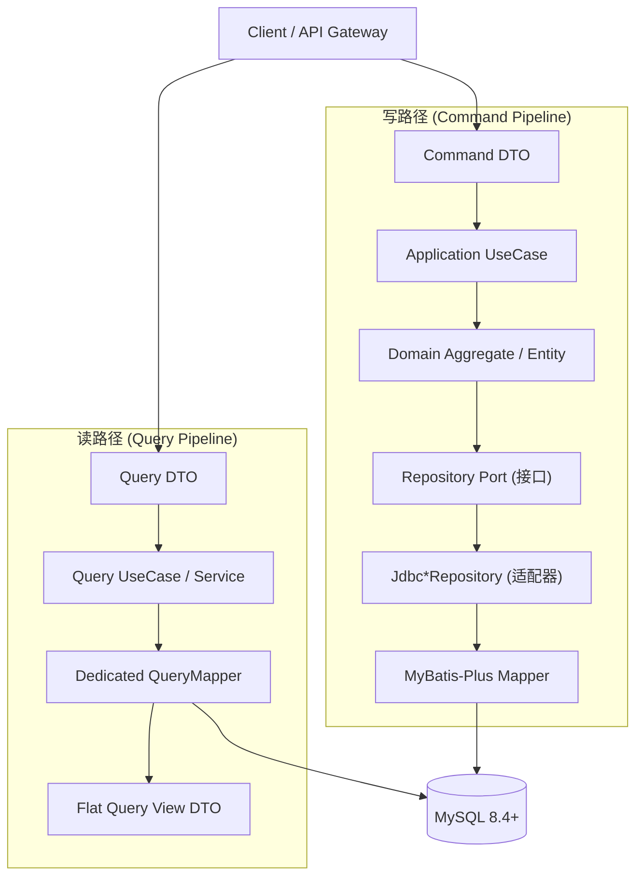

- **Domain Model (写模型)**：聚合根与实体严谨维护领域不变量，状态变更由领域方法触发（如 `user.disable()`）。
- **Query View Model (读模型)**：为前端列表、分页和统计专门设计扁平只读 DTO，避免跨表多次 N+1 查询。

---

### 11.2 仓储适配器模式 (Domain Port to Jdbc Repository)

应用层定义端口接口，基础设施层提供适配器实现：

- 端口位于 `com.enterprise.iam.<service>.application.port.out.*Repository`；
- 适配器位于 `com.enterprise.iam.<service>.infrastructure.persistence.repository.Jdbc*Repository`；
- 适配器内部注入对应的 MyBatis-Plus Mapper（如 `UserPersistenceMapper`），完成领域对象与持久化行对象（`*Row`）之间的双向转换。

---

### 11.3 100% MyBatis-Plus XML Mapper 规约与参数化防注入

根据架构红线铁律（SPEC 47 §5）：

1. **纯 XML 集中管理**：所有 SQL 一律维护在 `src/main/resources/mapper/**/*.xml`，杜绝任何内联注解 SQL；
2. **绝对防注入**：必须使用 `#{...}` 进行参数绑定，严禁使用 `${...}` 动态拼接字段；
3. **动态标签白名单**：允许使用 `<if>`, `<choose>`, `<when>`, `<otherwise>`, `<foreach>`, `<where>`, `<set>` 等标准 MyBatis XML 标签构建结构化动态 SQL。

#### 标准 XML Mapper 样例 (`UserPersistenceMapper.xml`)

```xml
<?xml version="1.0" encoding="UTF-8"?>
<!DOCTYPE mapper PUBLIC "-//mybatis.org//DTD Mapper 3.0//EN" 
    "http://mybatis.org/dtd/mybatis-3-mapper.dtd">
<mapper namespace="com.enterprise.iam.identity.infrastructure.persistence.mapper.UserPersistenceMapper">

    <select id="findById" resultType="com.enterprise.iam.identity.infrastructure.persistence.entity.UserRow">
        SELECT id, tenant_id, username, real_name, email, phone, department_id, position_id, status, version, created_at, updated_at
        FROM iam_user
        WHERE tenant_id = #{tenantId} AND id = #{userId}
    </select>

    <insert id="insertUser">
        INSERT INTO iam_user (id, tenant_id, username, real_name, email, phone, department_id, position_id, status, version)
        VALUES (#{id}, #{tenantId}, #{username}, #{realName}, #{email}, #{phone}, #{departmentId}, #{positionId}, #{status}, 0)
    </insert>

    <update id="updateUser">
        UPDATE iam_user
        <set>
            <if test="realName != null">real_name = #{realName},</if>
            <if test="email != null">email = #{email},</if>
            <if test="phone != null">phone = #{phone},</if>
            <if test="departmentId != null">department_id = #{departmentId},</if>
            <if test="positionId != null">position_id = #{positionId},</if>
            version = version + 1
        </set>
        WHERE tenant_id = #{tenantId} AND id = #{id} AND version = #{version}
    </update>

</mapper>
```

---

### 11.4 租户多租户隔离拦截器与物理逻辑双层防串包

- **双层拦截防御**：
  1. **网关层校验**：检查 JWT Payload 中的 `tenant_id` 与请求头 `X-Iam-Tenant-Id` 是否匹配；
  2. **MyBatis 插件层拦截**：通过 `TenantLineHandler` 自动将当前请求上下文的 `tenant_id` 注入到所有业务查询与写入中，确保跨租户物理隔离。

---

### 11.5 深度分页防护与游标查询机制

为防止海量数据下 `OFFSET 1000000 LIMIT 20` 导致的数据库慢查询与内存耗尽：

- 严格限制最大每页条目数（`pageSize <= 100`）；
- 超过 10,000 条深度分页时，引导使用基于单调递增 ID 的游标分页（`WHERE id > #{lastSeenId} ORDER BY id ASC LIMIT #{pageSize}`）。

> [🔝 回到目录索引](#目录索引)

---

## 第十二部分 应用服务 领域聚合与分布式一致性 (Domain Aggregate and Consistency)

### 12.1 核心领域聚合根与值对象清单

| 微服务                 | 聚合根 (Aggregate Root) | 内部实体与值对象                            | 业务边界不变量               |
| :------------------ | :------------------- | :---------------------------------- | :-------------------- |
| `iam-auth`          | `AuthCredential`     | `PasswordHash`, `WebAuthn`          | 凭据唯一性；Argon2id 安全基线   |
| `iam-auth`          | `AuthSession`        | `SessionToken`, `FamilyId`          | 家族轮换单次消费；盗用即作废        |
| `iam-identity`      | `Tenant`             | `TenantCode`, `TenantStatus`        | 租户全局唯一编码；状态流转受限       |
| `iam-identity`      | `User`               | `Username`, `Email`, `DeptRef`      | 租户内用户名唯一；停用联动会话强退     |
| `iam-identity`      | `Menu`               | `MenuCode`, `MenuType`, `Route`     | 树形无环；发布/草稿状态机         |
| `iam-identity`      | `PermissionApproval` | `ApprovalDecision`, `Justification` | 动态 SoD 申请人审批人互斥；批准即赋权 |
| `iam-organization`  | `Organization`       | `OrgCode`, `ClosureDistance`        | 部门树防环；闭包表距离一致性        |
| `iam-organization`  | `Position`           | `PositionCode`                      | 独立岗位主数据；在用引用防删保护      |
| `iam-organization`  | `Team`               | `TeamMember`, `TeamRole`            | 矩阵式协作；成员移除权限即刻收敛      |
| `iam-authorization` | `Resource`           | `Operation`, `PermissionEffect`     | 四级元数据映射；权限即数据         |
| `iam-sharing`       | `ShareAcl`           | `ShareScope`, `Epoch`               | 权利下限原则；单调递增投影纪元       |
| `iam-file`          | `LogicalFile`        | `PhysicalObject`, `ScanResult`      | CAS 秒传与合并；病毒/DLP 拦截   |

---

### 12.2 入站命令 (Command) 与查询 (Query) 规范与入参校验

- 入站 Command 必须是不可变对象（Java Record 或带全参构造函数），并在进入应用层前完成 JSR-380 / Bean Validation 格式校验。
- 业务前置条件（Preconditions）在聚合根内部完成断言，违背时抛出领域特定异常（如 `CycleDetectedException`）。

---

### 12.3 Transactional Outbox 事务边界与投递机制

1. **同库本地事务落库**：业务写操作与 `iam_outbox` 待发送记录在**同一个本地数据库事务**中提交。
2. **状态与重试**：Outbox 轮询线程以每秒 500 条的吞吐拉取 `status = 'PENDING'` 记录发送至 RabbitMQ；成功后推进为 `PUBLISHED`，失败则依据指数退避算法重试最大 5 次，超出后送入死信告警表。

---

### 12.4 Redis Lua 原子租约幂等机制与状态机

为保障金融级分布式调用与网络重试场景下的绝对幂等，`iam-idempotent-spring-boot-starter` 基于 Redis Lua 脚本实现租约状态机：

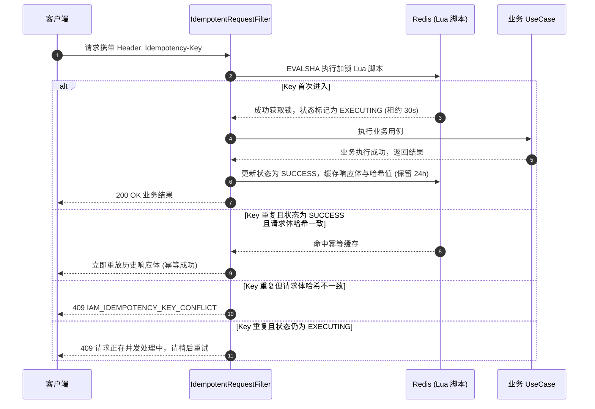

---

### 12.5 跨服务领域事件全目录 (Domain Events Schema and Payloads)

| 事件名称                          | Exchange / Routing Key    | 产生源微服务                      | 消费方微服务                                  | 业务触发与语义                      |
| :---------------------------- | :------------------------ | :-------------------------- | :-------------------------------------- | :--------------------------- |
| `TenantBootstrappedEvent`     | `iam.tenant.bootstrapped` | `iam-identity-service`      | `iam-file-service`, `iam-audit-service` | 租户引导完成，分配存储与审计空间             |
| `UserDisabledEvent`           | `iam.user.disabled`       | `iam-identity-service`      | `iam-auth-service`, `iam-gateway`       | 用户停用，全端踢退会话                  |
| `RolePermissionsUpdatedEvent` | `iam.role.updated`        | `iam-authorization-service` | `iam-authorization-service` (本地缓存), 网关  | 角色权限集变更，推进 permissionVersion |
| `ShareGrantedEvent`           | `iam.share.granted`       | `iam-sharing-service`       | `iam-authorization-service`             | 跨主体共享创建，物化投影并推进 Epoch        |
| `ShareRevokedEvent`           | `iam.share.revoked`       | `iam-sharing-service`       | `iam-authorization-service`             | 共享撤销，物理标记撤销并推进 Epoch         |
| `FileScanCompletedEvent`      | `iam.file.scanned`        | `iam-file-service`          | `iam-audit-service`                     | 文件病毒/DLP扫描完成，更新可见性           |

#### 典型事件载荷示例（`ShareRevokedEvent`）

```json
{
  "eventId": "100293847291029384",
  "eventType": "ShareRevokedEvent",
  "occurredAt": "2026-10-24T22:30:00.123Z",
  "tenantId": "1",
  "traceId": "trace-918237198273",
  "payload": {
    "shareId": "5001239847192",
    "resourceId": "8810293",
    "targetType": "USER",
    "targetId": "1002",
    "operationIds": ["301", "302"],
    "epoch": 4
  }
}
```

> [🔝 回到目录索引](#目录索引)

---

## 第十三部分 安全威胁模型与 STRIDE 防御矩阵 (Threat Modeling and STRIDE)

### 13.1 STRIDE 威胁矩阵与防御落地清单

| STRIDE 威胁类别                       | 潜在攻击场景                   | 系统内建防御技术措施                                                           |
| :-------------------------------- | :----------------------- | :------------------------------------------------------------------- |
| **S (Spoofing 仿冒)**               | 伪造 Token 或中间人伪造网关身份      | ES256 非对称 JWT 签名、HTTPS JWKS 轮转、网关内部签名委托头 HMAC 校验                     |
| **T (Tampering 篡改)**              | 修改请求体 ID 或越权修改角色绑定       | 全量输入 Schema 严格校验、幂等键携带请求体 SHA-256 哈希校验防篡改                            |
| **R (Repudiation 抵赖)**            | 管理员越权操作或执行敏感赋权后抵赖        | 事务性操作审计日志、全链路 MDC TraceId 贯通、导出审计日志数字指纹封存                            |
| **I (Info Disclosure 泄露)**        | API 返回过多敏感列、未授权查看他人薪资    | 列级 `FieldPolicy` 强制 `HIDE`/`MASK`、`TypedMasker` 动态掩码、Fail-Closed 全掩码 |
| **D (Denial of Service 拒绝服务)**    | 恶意构造高复杂度 ABAC DSL、高频暴力破解 | Condition DSL 深度 ≤ 8、Token ≤ 64 硬拦截；Argon2id 登录失败限流与验证码      |
| **E (Elevation of Privilege 提权)** | 共享越权（授予自身没有的权限）、SoD 冲突   | 共享边界严格下限校验；静态 SoD 互斥阻断；动态 SoD 自我审批禁止                                 |

---

### 13.2 20 大安全滥用案例 (Abuse Cases) 与系统级防范策略

1. **已作废 Refresh Token 窃取重放（Token Theft Abuse）**：
   - *攻击*：黑客窃取已被使用的 Refresh Token 尝试轮换获取新 Access Token。
   - *防御*：服务端维护 Token 家族（Family ID）。一旦已标记消费的 Token 再次被请求，系统判定攻击发生，即刻吊销该家族全部会话，触发全端强退。
2. **分布式网络乱序导致的撤权死灰复燃（Stale Projection Abuse）**：
   - *攻击*：管理员已撤销某共享，但由于网络分区，授权服务收到滞后的历史事件。
   - *防御*：单调递增 `Projection Epoch`。授权引擎校验当前投影纪元，一旦落后于预期纪元，直接触发 `503 IAM_SHARE_PROJECTION_STALE` 拒绝脏读。
3. **恶意超大压缩包炸弹瘫痪服务（ZIP Bomb Abuse）**：
   - *攻击*：上传几 KB 的高压缩比压缩包，解压后达数百 GB 耗尽服务器磁盘与内存。
   - *防御*：上传后流式计算解压比（阈值 100:1），单层解压大小超限或解压层数 ≥ 3 时，直接判定为恶意文件并触发 `423 IAM_FILE_SCAN_FAILED`。
4. **租户伪造请求头越权跨租户串包（Tenant Header Spoofing）**：
   - *攻击*：在 HTTP 请求头中传入伪造的 `X-Iam-Tenant-Id: 2` 尝试窃取其他租户数据。
   - *防御*：网关外部拦截并强制从验证通过的 JWT Token 中提取真实的 `tenant_id` 覆写该头，后端 MyBatis 拦截器物理注入租户隔离条件。
5. **动态 Condition DSL 表达式注入与 RCE（DSL Injection Abuse）**：
   - *攻击*：在 ABAC 条件中输入恶意的 Java 反射或脚本执行字符串。
   - *防御*：自研专用受限 AST 求值器，禁止任何外部函数反射调用，仅支持白名单安全操作符，语法深度严格 ≤ 8。
6. **未授权转分享权限提权（Reshare Privilege Escalation）**：
   - *攻击*：仅持有资源读权限的用户，尝试将该资源以写权限分享给他人。
   - *防御*：权利下限原则校验。系统自动计算授予者权限交集，超出原权限范围直接抛出 `403 IAM_SHARE_OPERATION_ESCALATION`。
7. **重放历史请求绕过幂等性（Request Replay Abuse）**：
   - *攻击*：截获支付或审批请求包并重复发送。
   - *防御*：Redis Lua 租约幂等机制，比对请求体 SHA-256 哈希值，若一致则幂等重放历史响应，不一致则判定为篡改并报错 `409`。
8. **硬件 Passkey 凭据物理克隆（Authenticator Cloning Abuse）**：
   - *攻击*：物理复制硬件安全密钥并向服务器发起认证。
   - *防御*：单调递增 `sign_count` 校验，若客户端上报计数值 ≤ 数据库存储值，判定克隆并即刻吊销凭证。
9. **暴力破解租户登录密码（Password Brute Force）**：
   - *攻击*：针对特定用户名进行高频字典猜测。
   - *防御*：Argon2id 高计算成本天然增加破解门槛，配合 IP/账号双重滑动窗口限流（1分钟5次失败触发15分钟锁定及验证码）。
10. **修改密码后旧设备持有 Token 持续越权（Zombie Session Abuse）**：
    - *攻击*：员工离职或改密后，其手机端已颁发的旧 JWT 在 15 分钟内继续访问系统。
    - *防御*：改密原子递增 Redis 中的 `session_version`，网关会话围栏毫秒级生效，旧 Token 立即返回 `401`。
11. **组织部门层级成环破坏（Hierarchy Cycle Abuse）**：
    - *攻击*：将根部门移动至其子部门下，导致全系统组织树死循环崩溃。
    - *防御*：闭包表层级距离检索，若目标父节点属于当前节点的后代节点，硬阻断并抛出 `422`。
12. **虚假假审批绕过真实授权（Fake Approval Bypass）**：
    - *攻击*：攻击者伪造审批单通过状态，试图在未授权情况下访问资源。
    - *防御*：审批人同意时，系统在单事务中原子执行物理权限表的增写（`iam_user_role` 等），授权决策只认底层真实权限事实，不认临时审批单据。
13. **利用大文件上传消耗存储带宽（Bandwidth Exhaustion Abuse）**：
    - *攻击*：海量大文件通过业务应用服务器中转上传造成网络瘫痪。
    - *防御*：Presigned PUT URL 直传 S3/MinIO 存储，流量完全绕开微服务核心节点。
14. **伪造文件名或扩展名绕过安全检查（MIME Spoofing Abuse）**：
    - *攻击*：将可执行的 `.exe` 伪装成 `.pdf` 上传。
    - *防御*：Magic Number 文件头魔数深度探测，与扩展名校验比对，不匹配直接标记违规。
15. **利用深度分页消耗数据库缓冲池（Deep Pagination DoS）**：
    - *攻击*：请求 `page=100000, pageSize=100` 导致数据库产生全表扫描和巨量回表。
    - *防御*：严格限制 `pageSize <= 100`，超限分页引导采用单调游标查询（`id > #{lastId}`）。
16. **越权访问他人敏感字段（Sensitive Field Snooping）**：
    - *攻击*：普通员工调用员工接口尝试读取高管薪资列。
    - *防御*：列级 `FieldPolicy` 判定，若未明确授权 `READ` 则直接在网关或序列化层剔除该字段，即使返回也是全掩码 `"***"`。
17. **伪造网关内部委托头越权（Service Identity Spoofing）**：
    - *攻击*：攻击者绕过网关直接向内部微服务发送伪造的 `X-Iam-User-Id` 头。
    - *防御*：微服务间启用 mTLS 双向认证，网关注入带有 HMAC-SHA256 签名的内部委托头，微服务校验签名后方才信任。
18. **删除在用岗位导致名册数据孤儿（Position In-Use Deletion）**：
    - *攻击*：删除关键行政岗位导致大量用户职位属性悬空。
    - *防御*：在用引用计数强制断言，关联人员数 > 0 时硬阻断删除并返回 `409`。
19. **草稿菜单非法提前暴露（Unpublished Menu Leakage）**：
    - *攻击*：普通用户通过 API 提前获取正在测试中的草稿菜单项。
    - *防御*：客户端拉取导航接口严格过滤 `publish_status = 'PUBLISHED'`，草稿仅在管理后台可见。
20. **审计日志篡改与抵赖（Audit Log Tampering）**：
    - *攻击*：攻击者获取数据库权限后删除或修改自己的高危操作审计记录。
    - *防御*：审计记录在生成时计算包含 TraceId、操作人和载荷的不可逆数字指纹，异步归档转存至只读 ClickHouse 及冷归档存储，杜绝事后篡改。

---

### 13.3 零信任内部服务互信与网关签名委托头机制

- 网关验签客户端 Token 后，使用内部共享对称密钥对主体信息（`userId`, `tenantId`, `roles`, `timestamp`）进行 HMAC-SHA256 签名，生成内部签名头 `X-Iam-Internal-Signature`；
- 下游微服务接收到请求时，验证签名有效性且时戳偏差在 30 秒以内，从而安全信任该主体身份，无需重复执行昂贵的 JWT 验签。

> [🔝 回到目录索引](#目录索引)

---

## 第十四部分 统一安全审计 可观测性与生产运营 (Observability, Audit and Operations)

### 14.1 全链路安全审计模型与 MDC TraceId 贯通

全链路统一集成 `MDC` 与分布式链路追踪：

- 请求自网关进入时，分配或透传唯一 `X-Iam-Trace-Id`；
- 跨 HTTP 调用、异步 MQ 消息与 Scheduled Job 执行全程保留 TraceId；
- 审计记录包含：租户、操作人、目标资源、动作、来源 IP、客户端环境、决策结论、耗时与 TraceId。

---

### 14.2 ClickHouse/OLAP 高速聚合与审计冷归档导出

- **实时消费入库**：审计微服务异步监听安全事件，批量写入 ClickHouse 物理表；
- **OLAP 秒级聚合**：支持海量日志按租户、用户、时间范围进行多维分析、行为异常挖掘与安全合规报表生成；
- **冷归档导出**：超过指定保留期（如 180 天）的历史日志，自动压缩归档转存至冷存储，降低主库存储成本。

---

### 14.3 分布式调度中心 (iam-job-service) 定时任务全量清单

| 任务名称                          | 执行周期 (Cron)      | 核心治理职责                                                    |
| :---------------------------- | :--------------- | :-------------------------------------------------------- |
| `OrphanSessionCleanupJob`     | `0 */15 * * * ?` | 扫描未确认登录交付或超绝对空闲时限的僵尸会话，清理 Redis 并更新数据库状态                  |
| `ShareExpirationReconcileJob` | `0 */5 * * * ?`  | 扫描到期的 `iam_share_acl`，标记过期并原子自增推进对应资源的 `projection_epoch` |
| `TenantQuotaReconcileJob`     | `0 0 2 * * ?`    | 深度比对 MinIO 物理 S3 占用与数据库记录，校准租户逻辑配额，清理断点遗留碎片               |
| `AuditColdArchiveJob`         | `0 0 3 * * ?`    | 导出超过 90 天的历史审计数据压缩为 Parquet/CSV 转储至 S3 Glacier 冷存储        |

---

### 14.4 生产 SLO 指标体系与容量规划

#### 核心 SLO 体系

- **网关验签与拦截延迟**：P99 ≤ 5 ms。
- **决策引擎单次决策延迟**：P99 ≤ 10 ms（基于本地 Caffeine + Redis 多级缓存）。
- **可用性目标（SLO）**：核心认证鉴权流水线保障 ≥ 99.99% 高可用。

#### Prometheus 监控度量指标清单

- `iam_http_requests_total{service, method, status}`：HTTP 请求总量与状态分布；
- `iam_http_request_duration_seconds{service, path}`：HTTP 请求耗时分布直方图；
- `iam_auth_login_total{tenant, status, method}`：认证登录次数（成功/失败）；
- `iam_authz_decision_total{tenant, resource, decision}`：授权决策计数（ALLOW/DENY）；
- `iam_outbox_pending_count{service}`：各微服务待发送 Outbox 消息积压数；
- `iam_file_upload_bytes_total{tenant}`：租户文件上传吞吐量。

---

### 14.5 基础中间件 Docker Compose 运行时部署规格与编排架构

为了支撑企业级 IAM 微服务集群本地联调、CI/CD 自动化集成测试与基准运行时验证，系统在 `deploy/` 目录下提供了生产对齐的一键式基础中间件 Docker Compose 编排拓扑与运维脚本集：

#### 核心编排服务与端口映射清单

| 容器服务名 | 镜像版本 | 宿主机/容器端口 | 核心职能与持久化卷 | 健康检查 / 依赖关系 |
| :--- | :--- | :--- | :--- | :--- |
| **`mysql`** | `mysql:8.4` | `3306:3306` | 预初始化 8 大微服务及 Nacos 数据库，挂载 `iam_mysql_data` | `mysqladmin ping`，`interval: 5s` |
| **`redis`** | `redis:7-alpine` | `6379:6379` | 会话版本栅栏、L2 决策缓存与防重放锁，AOF 挂载 `iam_redis_data` | `redis-cli ping`，`interval: 5s` |
| **`rabbitmq`** | `rabbitmq:3.13-management` | `5672:5672`<br>`15672:15672` | 领域事件总线 `iam.domain.events` 异步广播，挂载 `iam_rabbitmq_data` | `rabbitmq-diagnostics check_running` |
| **`minio`** | `minio/minio:RELEASE.2025-04-22T22-12-26Z` | `9000:9000`<br>`9001:9001` | S3 大文件分片暂存与审计 Parquet 冷存储，挂载 `iam_minio_data` | `mc ready local`，`interval: 5s` |
| **`minio-init`** | 复用 `minio/minio` (内置 `/usr/bin/mc`) | *(无外部端口)* | 自动初始化 `iam-files` 与 `iam-audit-cold-archive` 存储桶（免依赖已受限的 `minio/mc` 外部镜像） | `depends_on: minio (condition: service_healthy)` |
| **`nacos`** | `nacos/nacos-server:v2.3.2` | `8848:8848`<br>`9848:9848`<br>`9849:9849` | 单机模式配置与服务发现中心，Derby 内置持久化挂载 `iam_nacos_data` | `curl -f http://localhost:8848/nacos/v1/console/health/readiness` |
| **`seata-server`** | `seataio/seata-server:1.7.0` | `8091:8091`<br>`7091:7091` | 分布式事务协调器（TC），支撑微服务跨库强一致事务与 AT 模式协调 | `seata-server -m file` |

#### 微服务多库隔离与 Flyway 协同规格

MySQL 容器通过 `deploy/mysql/init/01-init-databases.sql` 在首次启动时自动创建以下 8 个完全隔离的微服务物理数据库：
- `iam_auth`: 认证会话、密码凭据与授权码；
- `iam_identity`: 用户账户、租户主体与档案拓展；
- `iam_organization`: 部门树状架构、岗位职位与用户归属；
- `iam_authorization`: RBAC 角色、功能权限、ABAC 规则与数据范围过滤模型；
- `iam_sharing`: 协同共享 ACL 策略与时间窗口委托；
- `iam_file`: 文件元数据、断点分片索引与对象存储配额；
- `iam_audit`: 统一不可变审计日志、安全告警事件与合规流水；
- `iam_job`: 分布式调度触发器与任务执行心跳日志。

各微服务启动时由内置的 Flyway 引擎自动拉取并执行 `src/main/resources/db/migration/V<N>__*.sql` 脚本，完成零人工干预的平滑演进与幂等升级。

#### 一键运维脚本套件

运维工具集中存放于 `deploy/scripts/`，采用 PowerShell 编写，支持本地及 CI 流水线调度：
- `deploy/scripts/start-infra.ps1`：环境预检、检测 Docker 守护进程，并在前台按健康依赖关系启动全量基础中间件；
- `deploy/scripts/stop-infra.ps1`：安全平飞终止容器集群，支持 `-RemoveVolumes` 标志位完成重置清库；
- `deploy/scripts/check-infra.ps1`：逐一探测各中间件 TCP 端口连通性及 HTTP 健康检查端点状态。

> [🔝 回到目录索引](#目录索引)

---

## 第十五部分 架构裁决台账与开放决策寄存器 (Architecture Decisions Register and Gates)

### 15.1 D-1 至 D-25 架构裁决全面拆解与执行标准

| 裁决编号     | 核心决策内容                | 权威执行标准与禁止项                                                  |
| :------- | :-------------------- | :---------------------------------------------------------- |
| **D-1**  | 租户编码字符集规范             | 必须小写字母开头，支持小写字母、数字与中划线，3-64 位（正则：`^[a-z][a-z0-9-]{2,63}$`）。 |
| **D-2**  | 64 位雪花算法 ID 传输防截断     | JSON 序列化一律转十进制字符串，数值字段显式保留 `@NumericLong`。杜绝前端 JS 截断。       |
| **D-3**  | 认证密码学标准               | 强制 Argon2id 哈希，拒绝明文或不可逆的旧算法（如 MD5/SHA1）。                    |
| **D-4**  | 令牌签名算法                | 统一 ECDSA ES256，通过标准 HTTPS JWKS 终端对外暴露公钥。                    |
| **D-5**  | Refresh Token 安全边界    | 仅允许存在于 HttpOnly Secure Strict Cookie，禁止返回给前端 JS 读取。         |
| **D-6**  | 网关签名委托头               | 网关将已验签的主体身份签名后注入内部头，下游服务直接互信。                               |
| **D-7**  | 授权决策失败默认闭合            | 发生依赖中断或版本落后时，一律判定为 DENY 或返回 503，严禁降级放行。                     |
| **D-8**  | 数据范围 SQL 编译防注入        | 谓词生成强制使用 AST 参数化绑定，严禁使用原生字符串拼接。                             |
| **D-9**  | 脱敏掩码丢失防泄密             | 脱敏策略异常或缺失时，强制回退为全局全掩码 `"***"`。                              |
| **D-10** | 大文件上传架构               | 前端 Web Worker 增量哈希秒传 + 分片 Presigned PUT 直传 S3/MinIO。        |
| **D-11** | 文件安全扫描状态机             | 上传合并后必须置为 SCAN\_PENDING，扫描通过后方可开放下载。                        |
| **D-12** | 跨服务投影纪元单调围栏           | 共享 ACL 引入单调递增 Epoch，防止分布式网络乱序脏读。                            |
| **D-13** | 事务性 Outbox 事件广播       | 业务写与事件记录在同本地事务提交，防双写不一致。                                    |
| **D-14** | 登录交付确认与孤儿会话回收         | 客户端须发送确认包，未确认会话由 Job 定时回收。                                  |
| **D-15** | 修改密码会话版本推进            | 用户改密或停用时，原子递增版本号，秒级踢出全端旧 Token。                             |
| **D-16** | Redis Lua 原子幂等状态机     | 引入加锁与完成两阶段 Lua 脚本，支持防重放与结果缓存。                               |
| **D-17** | 外部密钥管理服务 (KMS) 抽象     | 提供标准 KeyProvider 接口，支持对接外部 HSM/KMS 或本地密钥。                   |
| **D-18** | MinIO 物理擦除适配器         | 文件过期删除调用标准物理擦除，保障合规与不可恢复。                                   |
| **D-19** | 共享目标直读展开              | 支持直接向 ROLE 与 TEAM\_ROLE 分享，授权引擎执行动态扁平化。                     |
| **D-20** | Seata 跨库事务与撤销协同       | 分布式撤销场景集成 Seata 事务管理器与本地补偿机制。                               |
| **D-21** | 服务端驱动前端导航 Schema      | 前端导航栏通过 `/admin/v1/navigation/schema` 动态下发并渲染。              |
| **D-22** | 分布式调度服务独立设防           | 独立 `iam-job-service` 避免在业务微服务节点上竞争资源。                       |
| **D-23** | 页面与字段元数据驱动 (SPEC 20)  | 按钮级别 `operations` 与字段 `columns` 由服务端元数据下发。                  |
| **D-24** | 调度中心租户配额巡检            | Job 服务支持多租户维度的定期容量审计与过期资源清理。                                |
| **D-25** | 全量持久化纯 MyBatis XML 规范 | 生产代码杜绝一切注解 SQL 与 JdbcTemplate，100% 采用 XML Mapper。           |

---

### 15.2 DEC-001 至 DEC-014 生产准入清单与 Fail-Closed 默认安全值

| 决策编号      | 领域模块             | 生产准入条件与 Fail-Closed 安全默认值                           |
| :-------- | :--------------- | :-------------------------------------------------- |
| `DEC-001` | 密码加密参数           | 未接入外部定制时，强制使用 Argon2id (Memory 64MB, Iterations 3)。 |
| `DEC-002` | JWKS 轮转周期        | 密钥默认 90 天自动轮转，旧公钥保留 7 天宽限期。                         |
| `DEC-003` | 委托头签名算法          | 默认采用本地对称 HmacSHA256 签名，生产可配置为非对称签名。                 |
| `DEC-004` | 登录重试限流           | 单 IP/账号 1 分钟内连续失败 5 次，锁定 15 分钟并触发验证码。               |
| `DEC-005` | 会话最大并发数          | 单用户默认最大允许 5 个并发活跃会话，超出后挤退最早登录设备。                    |
| `DEC-006` | 权限缓存最大容量         | 本地 Caffeine 最大保留 50,000 条条目，TTL 设定为 60 秒。           |
| `DEC-007` | 数据范围超时阈值         | SQL 谓词编译解析超时上限 200ms，超时直接拒绝查询。                      |
| `DEC-008` | 字段脱敏回退策略         | 文本格式异常一律全掩码为 `"***"`，绝不输出源字符串。                      |
| `DEC-009` | 分片上传时效           | 分片上传会话有效期 24 小时，超时后未合并碎片由清理 Job 回收。                 |
| `DEC-010` | 扫描检毒超时           | 扫描超过 300 秒判定为 `SCAN_FAILED`，Fail-Closed 保持锁定状态。     |
| `DEC-011` | 幂等锁默认租约          | 并发请求租约锁超时上限 30 秒，结果缓存保留时长 24 小时。                    |
| `DEC-012` | Outbox 投递重试      | 连续失败重试最大 5 次，失败后进入死信告警队列人工介入。                       |
| `DEC-013` | 审计冷存储分界          | 生产日志活跃期 90 天，超过 90 天必须归档转移至冷存储。                     |
| `DEC-014` | Condition DSL 限制 | 深度 ≤ 8、Token ≤ 64、长度 ≤ 1024，超出直接抛错阻断。   |

---

> **纲领声明**：本规范集（`spec.md`）整合重构了系统规划中的 47 项子规范、25 项架构裁决与 14 项生产准入清单，为 `enterprise-iam` 平台的全生命周期交付与演进确立了权威基线。

> [🔝 回到目录索引](#目录索引)

